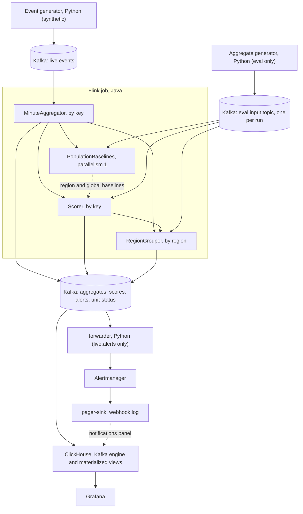
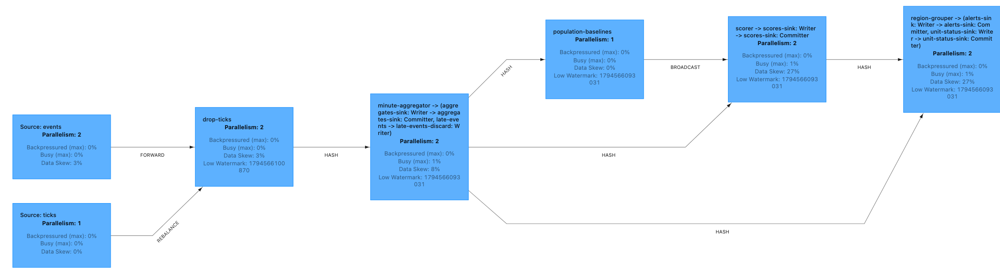
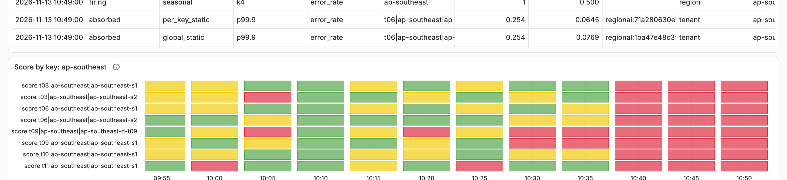
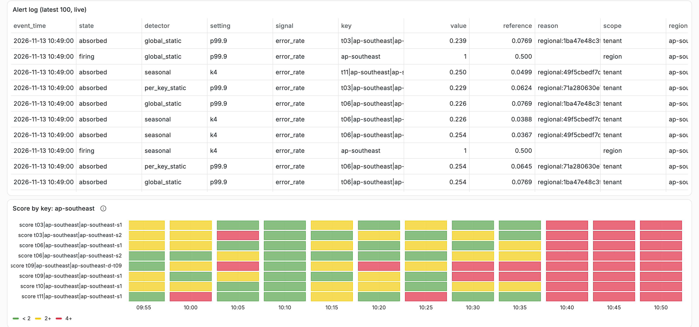
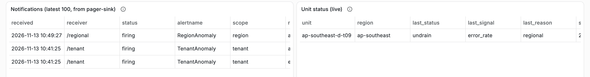

# tenant-baselines

[](https://github.com/SanchayPahalwani/tenant-baselines/actions/workflows/ci.yml)

A laptop-sized reference pipeline for multi-tenant anomaly alerting. Request events go through Kafka into a Flink job. The job builds per-minute aggregates for each tenant, region and unit, scores them against a baseline and writes alerts back to Kafka. ClickHouse and Grafana show the data, and Prometheus Alertmanager routes the alerts.

The question it tests: when traffic follows working hours, does a baseline per key and hour of the week catch more incidents and page less than fixed thresholds? On the synthetic replays here, the answer is partly yes and partly not settled. The figures are under [Results](#results).

**Synthetic data only.** Every event comes from the generator in `py/`; none of it describes a real system, and nothing here claims production use.

## Architecture



For each key and minute, the job builds an aggregate, scores error rate, latency and volume against the key's baseline for that hour of the week, and raises or resolves an alert. Each tenant alert is held briefly; if enough of a region's active tenants alert on the same signal, one regional alert forms and mutes the tenant alerts. Alerts go to a Kafka topic, to ClickHouse and Grafana, and through a forwarder to Alertmanager and a webhook log.

The running job in Flink's web UI during `make demo` (synthetic data):



## Quick start

Prerequisites: Docker with at least 8 CPUs and 10 GB of memory, `make`, and [`uv`](https://docs.astral.sh/uv/). The compose network uses the fixed subnet 10.231.0.0/24; change it in `docker-compose.yml` if it clashes with a local network. Published ports listen on 127.0.0.1 only.

```sh
make reset   # make demo needs an empty stack
make demo    # build the job, start the stack and the generator, submit the job, wait for warm-up
```

The generator writes three weeks of synthetic history at full speed and then continues live. Warm-up takes a few minutes. `make demo` prints the Grafana, Alertmanager and Flink URLs, the times of the three scripted incidents, and what to watch for. The demo has three tenants with a flat synthetic profile, so a regional alert can form at any hour.

Keep the machine awake while the demo runs. A sleep freezes the Docker VM, the job sees it as a total outage, and on wake the zero-traffic rule pages every busy key.

The Grafana dashboard has five panels: one key's signals against its baseline band, the live alert log, the score by key for each region, the notifications the webhook received, and the unit status.

The screenshots below come from one `make demo` run on synthetic data. They show what the demo looks like, not results.

A tenant's error rate climbs out of its baseline band during the scripted error burst on its dedicated unit:



The error spike across the region: one regional alert forms and absorbs the tenant alerts, and the region's scores turn red:



What the webhook received, and the dedicated unit that the regional alert released:



- `make smoke` runs the demo and checks it end to end. Run `make reset` first.
- `make test` runs the unit tests. `make ci` runs the same commands as the GitHub Actions workflow, `.github/workflows/ci.yml`, locally.
- `make eval-dev` runs one small eval seed on your machine. It is a dev run, not a repeat of the official runs.
- `make bench` runs the three performance measurements. It takes a long time and needs the lid open.
- `make down` stops the stack. `make reset` also deletes its data, including retained checkpoints.

The ClickHouse user `tb` with password `tb-local` is a local demo credential, not a secret.

Notes:

- `make test-java` can fail once after a host sleep steps the VM's clock. Run it again.
- The Flink CLI prints `Unknown module: jdk.compiler` when it starts. It is harmless.

## Results

All figures come from synthetic data on one laptop. They are not evidence about any real system.

### Detection eval

The eval compares three detectors on labelled, synthetic replays: the seasonal baseline, a static threshold per key, and one global static threshold per signal. Each has four settings, and each seed picks its own setting on week 4 of a five-week replay. The result below is that setting on week 5. Five seeds run at three day/night amplitudes (1.5:1, 6:1 and 12:1). Recall counts a scenario when a page lands on the signal the scenario moves. The scenario table was fixed before any run.

**What the result shows.** All traffic is synthetic, and it follows working hours because the generator says so. The eval tests whether this implementation delivers the benefit when that assumption holds, and how the benefit changes as seasonality weakens. It is not evidence about any real fleet, and it makes no claim of production use.

At the main amplitude (6:1), pooled over the 5 seeds (copied from [docs/results.md](docs/results.md); `py/tests/test_docs.py` checks the copy and every figure below against the records):

| Family | Expected-signal recall, pooled k/n (interval) | False pages per day, pooled |
|---|---|---|
| seasonal | 45/50 (0.79–0.96) | 9.63 |
| per key static | 38/50 (0.63–0.86) | 21.20 |
| global static | 31/50 (0.48–0.74) | 12.69 |

At 6:1 the seasonal detector found more scenarios than either static detector. Pooled over the seeds it had fewer false pages per day than both (9.63 against 21.20 and 12.69). Per seed, the global static range (5.29–17.71) overlaps the seasonal range (7.86–11.14), so the gap to global static is not settled with 5 seeds. The recall intervals of seasonal and per key static overlap, so with 5 seeds that recall gap is not settled. Most pages are false in every family: at the selected settings, 73 of 410 pages matched a scenario (seasonal), 60 of 802 (per key static) and 51 of 495 (global static). The traffic model's unlabelled bursts and per-day level factors (spec 5.2) are the expected cause; this eval does not measure the split. Every official seed selected k6 for the seasonal detector; the demo and the delay benchmark run k4, which had 34.57 false pages per day on the same week. At 1.5:1 the seasonal detector found every scenario (50/50), but the global static detector had fewer false pages per day (12.46 against 13.63, pooled). The full tables, the sweep, every setting and the per-scenario results are in [docs/results.md](docs/results.md).

`make eval` ran the 15 official runs. Each pair runs once, so it now only renders `docs/results.md`. `make results` renders the same file from the committed records and needs no Docker. The runs took 40.5 minutes on this machine (an Apple M3 Pro laptop), from the first run's start to the last run's end in `docs/results/official-runs.jsonl`. A re-run after a bug fix (spec 5.3) follows the steps in the comment above `eval` in the `Makefile`. `make check-paths` sends one synthetic world through the job as events and as pre-built minute aggregates. At commit `e57f621`, with a jar built from the same source as the frozen one (`flink-job/pom.xml`, `flink-job/src/main` and `shared/` are unchanged since 9f25a23), both alert logs and both sets of aggregates were identical ([docs/results/check-paths.json](docs/results/check-paths.json)). The check took 46.5 minutes on this machine. It checks that the two paths agree, not that the detectors are right.

The host and Docker VM facts for the official runs are in [docs/results/machine.json](docs/results/machine.json), once; the summaries do not record them per run.

### Performance

Three measurements on one laptop, on synthetic data. The machine, the method and the limits are in [docs/performance.md](docs/performance.md). They are not evidence about any real system or any larger deployment.

<!-- performance:begin -->
| Measurement (synthetic data, one laptop) | Figure |
|---|---|
| Sustained throughput of the live job, 2,000 keys | 179,224 and 151,897 events a second (2 runs) |
| Pipeline delay, seasonal/k4 | p50 21.6 s, p95 22.5 s (n=60) |
| Time to page, incident start to the alerts topic | p50 296.7 s, p95 324.4 s, minimum 269.4 s (n=60) |
| Watermark lag during the delay run | median 21.8 s (21.3 to 23.1) |
| Scorer state per key, mean over 48 keys after 5 replayed weeks (hashmap) | 622,238 bytes |
<!-- performance:end -->

Time to page includes the confirmation minutes and the hold, both configured. It ends at the alerts topic, before the forwarder and Alertmanager.

## Design

[docs/design.md](docs/design.md) gives the reason for each choice, why there is one OLAP store, and what a much larger deployment would change. The eval figures are in [docs/results.md](docs/results.md) and the measurements in [docs/performance.md](docs/performance.md).

The planning material: [the spec](docs/process/specs/2026-11-09-tenant-baselines-design.md), [the milestone 1 plan](docs/process/plans/2026-11-09-m1-static-end-to-end.md), [the milestone 2 plan](docs/process/plans/2026-11-10-m2-seasonal-baselines.md), [the milestone 3 plan](docs/process/plans/2026-11-11-m3-alert-noise-control.md), [the milestone 4 plan](docs/process/plans/2026-11-12-m4-eval.md), [the milestone 5 plan](docs/process/plans/2026-11-12-m5-throughput-delay.md) and [the milestone 6 plan](docs/process/plans/2026-11-13-m6-readme-design.md).

How it was built: AI coding agents (Claude Code) wrote the code, tests and documents from the spec and the milestone plans in `docs/process/`. The spec marks which choices were the owner's decisions and which were the builder's calls.

## What this repo does not do

- No production hardening: no TLS, no auth, one broker, no high-availability JobManager, no schema registry, containers run as root.
- No evidence about real traffic. All data is synthetic.
- Nothing acts on unit status. It is only published.
- No holiday calendars, no DST handling and no change-point detection.
- One OLAP store only.
- No OTLP ingest, no Kubernetes operator and no "what changed" note on an alert.
- You can run dev seeds with `make eval-dev`, but you cannot repeat the official runs.
- The eval does not split false pages by cause.
- Alert delay was not measured with a sparse partition or across a failover.
- Alertmanager silences do not survive `make down`.
- The job's jar is not published.

More in [docs/design.md](docs/design.md).

Licensed under Apache-2.0.
