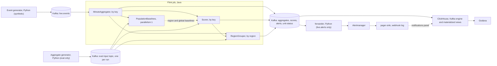

# tenant-baselines: design

**Synthetic data only.** Every event and incident here comes from a generator in `py/`, and every figure from runs on one laptop. None of it describes a real system. The figures are not evidence about any real system or any larger deployment, and nothing here claims production use.

This document gives the reason for each choice in [the spec](superpowers/specs/2026-11-09-tenant-baselines-design.md), what the choice costs, and where the build departs from the spec. It follows the data through the pipeline, then the eval, then the measurements.

## 1. What this is

- `tenant-baselines` is a small reference pipeline for multi-tenant anomaly alerting on service telemetry (spec 1). Kafka feeds a Flink job. The job writes Kafka topics, ClickHouse and Grafana show them, and Prometheus Alertmanager routes the alerts.
- It runs on one laptop, in a Docker VM of 8 CPUs and 10 GB (owner's call, spec 3).
- **The claim under test.** Fixed thresholds fit badly when traffic follows customers' working hours. A threshold high enough to stay quiet at peak misses trouble at night. One low enough to catch it pages every afternoon. A baseline per key and hour of the week should catch more and page less.
- **How it is tested.** Labelled synthetic replays go through the same job. The repo publishes the numbers, the scripts and the commits that produced them, in [`docs/results.md`](results.md) and [`docs/performance.md`](performance.md).
- **What the eval can show.** The replay's traffic follows working hours because the generator says so. The eval tests whether this implementation delivers the benefit when that assumption holds. It also tests how the benefit changes as seasonality weakens.
- **What it cannot show.** Anything about real traffic. A result here does not transfer to a real fleet.

**How to read this document.**

- "(owner's call)" marks a decision of the owner: one of the spec's §10 decisions, or a dated amendment in the spec.
- "(builder's call)" marks a decision made while building. Each is recorded in the spec or in a milestone plan.
- Each choice is stated, then its reason, then what it costs.
- Measured figures sit in three blocks. Each is pasted unchanged from a script's output, and a test compares the two. They are the eval headline (§9), the performance table (§10) and the state extrapolation (§10).
- A few other figures sit on lines that end with a source tag, `([results](results.md))` or `([performance](performance.md))`. A test checks that every number on such a line appears in the file the tag names.
- A value marked "configured" is set in the code or in the stack's configuration. It is a design value, not a measurement. "spec 4.3" cites a section of the spec.
- The milestone plans hold the detail behind the builder's calls: [milestone 1](superpowers/plans/2026-11-09-m1-static-end-to-end.md), [milestone 2](superpowers/plans/2026-11-10-m2-seasonal-baselines.md), [milestone 3](superpowers/plans/2026-11-11-m3-alert-noise-control.md), [milestone 4](superpowers/plans/2026-11-12-m4-eval.md), [milestone 5](superpowers/plans/2026-11-12-m5-throughput-delay.md) and [milestone 6](superpowers/plans/2026-11-13-m6-readme-design.md). What the build left open is in [the open items](superpowers/open-items.md).

## 2. Architecture

- **Namespaces** (spec 4.1). A namespace is `live`, `eval` or `bench`. Each has its own topics: `<ns>.events`, `<ns>.aggregates`, `<ns>.scores`, `<ns>.alerts` and `<ns>.unit-status`, made by `infra/kafka/create-topics.sh`.
- ClickHouse has one database, `tb`. Each row carries an `ns`, taken from its source topic, and a `run_id`. *Reason:* one schema serves the demo, the eval and the benchmark. *Cost:* every query must filter on `ns`; the dashboard's queries of `tb` tables all read `ns = 'live'`.
- **The key** is `tenant|region|unit` (spec 4.1). A unit is shared by several tenants or dedicated to one.
- On a dedicated unit, the key's baseline is in effect that tenant's own baseline. So one tenant's trouble shows even when its region looks normal. *Cost:* a tenant on several units has a key per unit. Trouble spread thinly over its units is seen unit by unit.
- **Two input modes** (spec 4.1). Events mode parses events, assigns watermarks and builds minutes in `MinuteAggregator`. The live demo and the benchmark use it. Aggregates mode reads minute aggregates that were built outside the job. Only the eval uses it.
- The two modes share every operator from the minute aggregates on (`Pipeline.detect`). *Reason:* the eval can run many seeds in minutes (§9). *Cost:* the eval does not run the events path itself; `make check-paths` shows the two paths agree (spec 5.7).
- In aggregates mode each run has its own input topic with one partition, read by one subtask. Each row is stamped with the last millisecond of its minute, the time `MinuteAggregator` gives its output. So the grouper's timers land on the same minute ends in both modes (builder's call, milestone 4).
- **A line the spec's picture lacks.** The grouper reads the minute aggregates as well as the scorer's alerts, keyed by region. It needs them to know which tenants are active (`Pipeline.java`, §7).
- The job writes only to Kafka. ClickHouse reads the four output topics; the forwarder reads `live.alerts` only.

## 3. Events, watermarks and minute aggregates

- **Events** (spec 4.2). One event is one request: `ts` (event time, ms), `tenant`, `region`, `unit`, `latency_ms` and `ok`. They are JSON with short field names, on zstd-compressed topics.
- **A keyed process function, not a window** (builder's call). `MinuteAggregator` is a `KeyedProcessFunction`. *Reason:* silent keys must still produce minutes, and a window emits nothing for an empty minute. *Cost:* the operator manages its own timers and state.
- Each finished minute gives `count`, `errors` and `p95_latency_ms`. The p95 comes from a fixed log-bucket histogram of about 3% precision (spec 4.2). The Python aggregate generator uses the same buckets, read from `shared/`. So both modes can give identical minutes.
- **Zero-fill.** After its first event, a key emits zero-count minutes until it expires. *Reason:* silence is the strongest volume-down signal.
- **The end-of-input guard.** At the final watermark of a bounded replay, the zero-fill timer stops at the replay's end. Without it, the replay would emit zero minutes until every key expired, and page on all of them. `MinuteAggregatorTest.stopsZeroFillAtFinalWatermark` covers it.
- **Late events are counted, not re-aggregated.** An event behind the watermark goes to a side output and is counted as `lateEvents`. *Reason:* its minute has already closed and gone downstream, and the scorer expects one minute per key, in order. *Cost:* the event is lost, and the counter is the only sign.
- **Key expiry on event time** (spec 4.2). After 7 days of event time without a request (configured), event-time timers clear the key in each operator. The scorer first resolves each firing alert with reason `expired`. *Reason:* Flink's built-in state TTL counts processing time only, so it means nothing in a replay. *Cost:* each key holds a timer, and the scorer waits a 2-minute slack (configured) so the aggregator's last zero minutes cannot restart the key.
- **The replay watermark** (spec 4.2): a bound of 20 s, idleness after 30 s and watermark alignment across partitions (configured). The generator writes in time order per partition. Out-of-order writes would be dropped as late.
- **The live watermark** (spec 4.2). Each events partition has a bound of 20 s and goes idle after 60 s without an event (configured).
- A second source emits one tick a second, stamped with the TaskManager's wall clock, with the same bound. The two streams are unioned, and the ticks are dropped before `MinuteAggregator`. Its watermark is then the lower of the two.
- While the job is behind, after a backfill or a restore, that is pure event time. Once it has caught up, it is the wall clock less the bound, held back by the newest event of the slowest partition that is not idle.
- When every producer is silent, the partitions go idle and the ticks keep minutes closing. *Reason:* a total outage is exactly when minutes must keep closing, and a restore during the outage must not stop them.
- **The 2026-11-11 amendment** (owner's call). The tick source replaced a custom generator that latched to the wall clock. That generator could not advance after a restore during a total outage. It could also hand over to the wall clock while a partition still had unread events. *Cost:* the live watermark trusts two clocks, the producers' and the TaskManager's. The list below is what that costs.

### Where the live watermark can lose data

- Ticks use the TaskManager's clock; events use the producers' clocks. After a silence, producers more than about 20 s (configured bound) behind the TaskManager lose their first events as late.
- A forward step of the TaskManager's clock while partitions are idle closes minutes early. Events for those minutes are then late.
- Producers that buffer for more than 60 s (configured idleness) and then flush lose that data as late. Meanwhile the job alerts on the silence.
- At start, only `make demo` waits until every partition has data. A bare `scripts/submit-job.sh` on empty partitions drops history written later, and `lateEvents` is the only sign.
- Idleness is a wall-clock guess. After a restore, a partition with an unread backlog that delivers nothing for 60 s (configured) is left out, and its tail is dropped as late.
- The measured watermark lag is in §10's block. That run kept every partition busy. A sparse partition adds up to the 60 s idleness (configured); that case was not measured.
- **Clock step-back after a host sleep** (milestone 3). On this laptop the Docker VM's clock can step back after the host sleeps. Flink then refuses to start a task (`SubTaskInitializationMetrics`: endTs >= startTs). So `make test-java` can fail once after a sleep and pass when run again. A live job restarts.

## 4. The seasonal baseline

- **Buckets** (owner's call, spec 4.3). Each key has 168 hour-of-week buckets per signal, in UTC.
- Each bucket keeps one-minute values from the last 4 weeks, not counting the current week, in a ring of 5 weekly slots (`BucketHistory`). *Reason:* traffic that follows working hours repeats every week, and an hour of the week holds enough values for robust statistics. *Cost:* an hour bucket blurs changes within the hour (see "Known limits").
- **The statistic** (owner's call): the median, and a spread of 1.4826 × MAD (spec 4.3). *Reason:* robust statistics are the point. An outage last week barely moves the median. *Cost:* the bucket must keep its values, not a running sum. That history is most of a key's state (§10).
- **Every minute feeds the baseline** (owner's call), including minutes while an alert fires. *Reason:* the baseline then does not depend on what the detector decided, and the median keeps a short incident from moving it. *Cost:* a lasting problem is absorbed in about 2 weeks (spec 4.3), and its alert then resolves silently. The static opponents get the opposite treatment: their fit leaves incidents out (§6).
- **A score** is the distance from the baseline in units of spread, in the bad direction only (spec 4.3).
- **Error rate up** (builder's call on the floor). The spread is the larger of 1.4826 × MAD and √(p₀(1−p₀)/n), with p₀ the larger of the median and 0.5%, and n the minute's request count (spec 4.3). *Reason:* the second term is binomial sampling noise. Without it, MAD is 0 on most keys and a single error looks infinite. At n = 37, one error scores about 2.3 and two score about 4.6 (spec 4.3).
- **Latency up** (p95; builder's call on the floor). The spread is the larger of 1.4826 × MAD and 5% of the median (spec 4.3). *Reason:* MAD already holds the p95's sampling noise, because the history's minutes have similar counts. The 5% floor keeps a flat history from making a small rise look large.
- **Volume down, on the trailing 5-minute sum** (builder's call on the window). Expected is the sum of the five minutes' bucket medians.
- The spread is the larger of the square root of the five minutes' summed squared spreads and √expected (`VolumeRing.spread`). That equals the spec's √5 · 1.4826·MAD when the five minutes share a bucket (spec 4.3). *Reason:* per-minute volume cannot see silence on small keys. Silence scores √median, which reaches 4 only at 16 requests a minute. The 5-minute sum reaches 4 at about 3.2 requests a minute (spec 4.3). *Cost:* the sum carries a scenario's effect for 4 more minutes, which the static fit's mask follows (§6).
- **The zero-traffic rule** (spec 4.3), on every key, warm or cold. It fires on zero requests for 5 minutes in a row where at least 15 were expected. The chance of that by luck is about e⁻¹⁵.
- Expected comes from the baseline when there is one, and from the trailing 30-minute average otherwise (`ZeroTraffic`, `VolumeRing`).
- **Minimum evidence** (spec 4.3). Error rate and latency are not scored in a minute with fewer than 20 requests (configured). *Reason:* this follows from the sampling noise, not from tuning. Below 20, one error is 5 points or more and the p95 is roughly the maximum. *Cost:* small keys at night are not scored on these signals.
- **The pause rule.** An unscored minute pauses the fire and resolve streaks. It neither extends nor resets them (`AlertStateMachine`). *Reason:* a minute without evidence says nothing either way.
- **Caching** (spec 4.3). A bucket's median and spread cannot change during its hour, since the current week is not in its baseline. They are computed once, when the hour starts (`HourCache`).
- **State size.** The spec's estimate is about 600 KB per key (spec 4.3). §10 has the measured figure.

**Known limits** (spec 4.3):

- Hour buckets blur ramps within the hour. The spread is about 0.37 × the ramp's range, so ramp hours are less sensitive (spec 4.3). They do not false-fire.
- UTC buckets would shift an hour at a daylight-saving change. The synthetic world uses fixed offsets, and DST is a non-goal (§12).
- A lasting problem is absorbed into the baseline in about two weeks, and its alert then resolves silently.
- **Cold-bucket resolve** (milestone 3). A firing seasonal volume alert resolves when the key enters a bucket where it is cold.
- The zero-traffic rule turns an unscored volume minute into a calm one when a trailing expectation exists (`ZeroTraffic.adjust`). Five calm minutes resolve the alert, and it re-fires in the next warm bucket.
- This needs a key with warm and cold volume buckets at once. No eval world has one: a key is cold in every bucket for two weeks and warm in every bucket after. It is documented behaviour, not changed, since the job code is sealed.

## 5. Cold start

- **When a key falls back** (owner's call, spec 4.4). A key uses a fallback in a bucket while it has fewer than 2 weeks of data there. A week of data is at least 30 scored minutes in that bucket that week (configured, `BucketHistory`).
- **Error rate and latency fall back** to the region's baseline, then to the global one (`Scorer.baselineFor`). *Reason:* a new key in a region usually sees that region's error rate and latency. A population baseline is better than none.
- **Volume waits** for the key's own 2 weeks, and the zero-traffic rule covers it meanwhile. *Reason:* a key's volume is its own size, and other keys say nothing about it.
- **How the fallbacks are built** (builder's call). `PopulationBaselines` runs at parallelism 1. It keeps a log-bucket histogram of every key's minute values, per region and globally, per hour-of-week bucket and per week. Median and MAD are read from the histogram. *Reason:* a histogram has a fixed size whatever the number of keys. *Cost:* one subtask sees every minute aggregate (§11).
- When a bucket's hour ends, the operator broadcasts that bucket's baseline for next week, built from the last 4 weeks, the ending one included.
- **Why the broadcast cannot race.** The broadcast input is not ordered against the keyed input. An update arrives a week of event time before it is used, so it is in place when the bucket comes round. *Cost:* a fallback baseline is a week old.
- **The cold-start burst** (spec 5.4) is an error burst on a tenant that onboarded at the start of week 4. The owner had it placed literally, at any time in the week (milestone 4 plan).
- It has no volume rule, so it can land in minutes the seasonal detector does not score (milestone 4).
- At the selected settings on week 5, the cold-start burst was found on its expected signal in 2/5 scenarios by seasonal, 3/5 by per key static and 4/5 by global static ([results](results.md))

## 6. Fire, resolve and the static opponents

- **Fire and resolve** (owner's call, spec 4.5). A detector fires after 3 scored minutes in a row at or past its fire level. It resolves after 5 scored minutes in a row inside its resolve level.
- The seasonal default fires at 4 spreads and resolves under 2 (spec 4.5). *Reason:* three minutes filter one-minute noise, and the gap between the levels keeps an alert from flapping. *Cost:* no alert fires in under 3 minutes (§10).
- **What all three families share** (spec 4.5): this state machine, minimum evidence, the pause rule, the zero-traffic rule and regional grouping. Only the reference differs: a fixed threshold, or the hour-of-week baseline. *Reason:* the comparison then isolates the effect of the baseline.
- **Deterministic alert ids** (spec 4.5). An id is a hash of the detector, setting, scope, key or region, signal and start minute (`AlertIds`). *Reason:* a replayed or restarted job re-emits the same id, so duplicates collapse downstream (§8). A re-fire of the same key and signal has a new start minute, so it is counted.
- **Two static opponents** (owner's call, spec 4.6). Global static has one threshold per signal for every key. Per-key static gives each key its own fixed threshold.
- Both use the seasonal detector's signal definitions, the 5-minute volume sum included. A static detector resolves halfway between the calibration median and its fire level, which gives it the same hysteresis.
- **Thresholds are fitted outside the job** (builder's call). They are percentiles of the calibration minutes, computed in Python from the same minute aggregates the job sees. They go to a thresholds file with `valid_from` and `valid_to`, which the job loads at start. *Reason:* this avoids a streaming calibration operator and a broadcast race. It is also how an operator sets a static threshold: look at the history once, then fix it.
- A key with no calibration data uses the global threshold. A key needs 1,000 values for a signal to get its own threshold (configured, `thresholds.MIN_VALUES`).
- **Calibration that favours the opponent** (spec 4.6). The week-4 thresholds are fitted on weeks 1–3. The week-5 thresholds are refitted on weeks 1–4, keeping the percentile chosen on week 4.
- **The mask.** The minutes of every labelled scenario are left out of the fit, except the Monday-morning peak, which is part of every week. Seasonal gets no such help, since every minute feeds its baseline.
- **The 2026-11-12 amendment** (owner's call). The mask covers every labelled scenario but the Monday peak, launch surges and holiday dips included. The spec first said "labelled incident minutes". *Reason:* a surge left in the fit would lift the high-percentile latency thresholds to surge level.
- The mask runs from a scenario's start to 4 minutes past its end (builder's call). *Reason:* the 5-minute sum carries the scenario's effect that long.
- **The settings grids** (builder's call, spec 4.6), four per family. Seasonal fires at k ∈ {3, 4, 5, 6} and resolves at k/2.
- Per-key and global static use the percentiles {99, 99.9, 99.97, 99.99} for the up signals, mirrored as {1, 0.1, 0.03, 0.01} for volume (spec 4.6).
- The grids were fixed in the spec before any detector code existed, and frozen in `eval/freeze.json`.
- **The inclusive fire comparison** (milestone 4 ruling). Every detector fires at or past its level, as spec 4.5 says (`Level.judge`).
- The values are discrete: bucketed p95, error counts over request counts, whole 5-minute sums. So a static threshold is breached on calibration minutes more often than its nominal percentile, and static false pages run somewhat higher than the percentile alone suggests. *Why it was not changed:* spec 4.5 applies one state machine to every detector, and spec 4.6 says only the reference differs. A change would be a detector change after the freeze. `docs/results.md` states the effect in its method notes.

## 7. Regional grouping and unit status

- **Hold** (owner's call, spec 4.7). `RegionGrouper` holds each tenant alert for 2 minutes of event time (configured). *Reason:* the other tenants' alerts of a regional incident can arrive before any one of them pages. *Cost:* every tenant page waits 2 minutes (§10).
- **Promote.** When the hold ends, the grouper takes the share of the region's active tenants with an alert on the same detector, setting and signal.
- An active tenant has a key in the region averaging at least 20 requests a minute over the last hour (configured). A region needs at least 3 active tenants.
- At a share of at least 50% (configured, spec 4.7), one regional alert fires and absorbs the held tenant alerts, each logged as `absorbed`. Otherwise the tenant alert fires.
- A tenant alert that arrives while its group's regional alert fires is absorbed at once.
- **Regional resolve.** The share stays under 25% for 5 minutes (configured, spec 4.7).
- **Re-hold.** On a regional resolve, the absorbed tenant alerts that still fire go through a fresh hold. *Reason:* nothing goes silent.
- **Alerts already sent stay sent.** A tenant alert sent before the regional alert formed has already paged. The eval counts it.
- In the demo, an Alertmanager inhibit rule mutes its repeats while the regional alert fires, as a backstop (owner's call).
- **Night outages** (spec 4.7). At night few tenants may be active, so a regional outage can turn into several tenant pages. The eval reports whether a regional alert formed and how many pages there were.
- At the selected settings, a regional alert formed in all 5/5 week-5 outages in every family, with 3.00 pages per detected outage for seasonal, 2.20 for per key static and 2.40 for global static ([results](results.md))
- The two night outages, at Fri 05:08 and Wed 00:08 local time, formed a regional alert in every family, and the seasonal setting sent 1 and 4 pages for them ([results](results.md))
- **Unit status is published only** (owner's call, spec 4.8). The grouper writes `drain` and `undrain` events to the compacted topic `<ns>.unit-status`, shown in Grafana. Nothing acts on them. *Reason:* moving traffic is out of scope (§12). Publishing shows what the rule would do.
- **The drain rule** (builder's call). A unit drains while its keys show a sent error-rate or latency alert of the live setting. A held or absorbed alert does not count.
- On a dedicated unit, one tenant's alert is enough. The grouper counts a unit as dedicated when only one tenant sent it a request in the expiry period. On a shared unit, at least 2 tenants must alert on the same signal.
- Error rate is checked before latency (`UnitStatusTest.errorRateWinsWhenBothSignalsQualifyInTheSameMinute`).
- **No drain on volume down.** *Reason:* the cause of a traffic drop is often upstream of the unit.
- **No drain during a regional alert.** *Reason:* draining a whole region moves traffic nowhere. While the live setting has a regional alert on any signal, every drained unit of the region undrains with reason `regional`.
- **What a drained unit keeps**, read from `RegionGrouper.publishUnitStatus`. The grouper stores only the signal a unit was drained for, and emits no new drain while the unit is still called for.
- So a drained unit keeps the signal and reason it was first drained for until it undrains, even when what calls for it now is another signal or another reason. Its undrain names that first signal. No test pins this behaviour; the test is an open item.
- **An alert absorbed twice.** A tenant alert absorbed by two regional alerts writes two `absorbed` events with one `(alert_id, state)`. `tb.alert_log` keeps the later one. The eval reads the topic, so it sees both, and absorbed rows are not pages.
- **Two determinism edges** (milestone 3 ruling). First: the grouper records a unit's tenants as each minute arrives, not in a timer. A tenant whose first request falls between a timer and the watermark can count at that timer.
- Second: at a replay's tail, with another setting's regional alert at streak 0, a drain that an expiry makes possible moves to the region's next input timer.
- Both touch only `tb.unit_status` rows, never an alert or a page.

## 8. Sinks, storage and delivery

- **At-least-once output** (spec 4.9). The job writes only to Kafka, with Kafka's at-least-once delivery. *Reason:* exactly-once sinks release output only when a checkpoint commits. That would add up to a checkpoint interval, 30 s (configured), to every alert.
- **Exactly-once state.** After a failure the job restores its last checkpoint. Each operator's state then counts every input once. Output written after that checkpoint is written again, and the copies are removed downstream.
- **Checkpoints** (spec 4.9): every 30 s, the RocksDB backend, incremental checkpoints, a named volume and a fixed-delay restart (configured).
- **Deduplication by deterministic keys** (spec 4.9). ClickHouse's Kafka-engine tables read the topics, and materialized views copy the rows into `ReplacingMergeTree` tables.
- The tables' keys are `(ns, run_id, key, minute)` for `aggregates`, `(ns, run_id, key, signal, minute)` for `scores`, `(ns, run_id, alert_id, state)` for `alert_log`, and `(ns, run_id, unit, at)` for `unit_status`. The dashboards query with `FINAL` or `argMax`.
- `scores` holds the live seasonal setting only. Every other setting emits alerts only, which keeps the volume down.
- **ClickHouse pulls from Kafka** (owner's call, spec 4.9). *Reason:* no connector to run or configure. *Cost:* a row that fails to parse goes to `tb.ingest_errors`, which has no TTL (§12).
- **Topics are never deleted** (spec 4.9). Each eval run has its own input topic and a `run_id` on every record. So the Kafka-engine tables never point at a missing topic. *Cost:* topics pile up until `make reset` removes the volume.
- **Append-time stamps on `eval` and `bench`** (builder's call, milestone 4). Their output topics use `LogAppendTime`. *Reason:* a replay's event times are months old, and retention would delete the output before it is read.
- **The `live.*` topics are stamped with event time.** The broker's retention then deletes backfilled rows early, and the forwarder's rebuild from the start of `live.alerts` misses them.
- Those rows were never pages: the forwarder skips any alert decided more than 10 minutes after its event time. `LogAppendTime` on `live.*` would edit `infra/kafka`, a measured path (§9), so it stays open.

### Why a single OLAP store

- The four tables hold append-mostly rows, queried by time range and key.
- One store with a Kafka engine needs no connector, no second copy of the data and no second schema to keep in step.
- `ReplacingMergeTree` gives the idempotency that at-least-once output needs.
- A second store would add an ingest path to test, for a demo with one dashboard.
- What a second store would be for, cheap long retention and joins with other data, is in §11.

**Delivery** (builder's calls, spec 4.10):

- **The forwarder** reads `live.alerts` for the live setting only, seasonal `k4`. It re-sends each firing alert to Alertmanager every 60 s (configured). On a resolve it sends `endsAt` and keeps re-sending for 5 minutes (configured). *Reason:* Alertmanager expects a client to re-send firing alerts until they resolve.
- It skips an alert decided more than 10 minutes after its event time (configured), so backfilled history never pages. An incident still firing when the forwarder restarts keeps paging.
- That rule is the 2026-11-10 amendment (owner's call), written to match the milestone 1 build.
- On start, the forwarder rebuilds its firing set by reading the topic from the beginning.
- **Alertmanager** groups by `alertname`, `region` and `signal`, with a `group_wait` of 30 s, a `group_interval` of 5 minutes and a `repeat_interval` of 4 hours (configured).
- It routes regional and tenant alerts to separate receivers. Both are webhooks to `pager-sink`, which logs each notification. An inhibit rule mutes tenant alerts while a regional alert of the same region and signal fires. *Cost:* Alertmanager's timers run on the wall clock, so they cannot follow a replay. The eval reads its pages from the alerts topic instead (spec 5.5).
- **Grafana** shows one provisioned dashboard with five panels:
  - one key's three signals against the baseline band;
  - the live alert log, the latest 100 rows;
  - the score by key, repeated per region: one row per key, each cell the highest of the key's three scores in 5 minutes, yellow from 2 and red from 4, the live setting's resolve and fire levels (configured);
  - the notifications pager-sink received, one row per alert in each notification;
  - the live unit status, one row per unit.
- The dashboard opens with every region selected, so the score panel repeats once per region.
- The panels were checked on the running stack through Grafana's query API (`make smoke`, its dashboard check). No fallback was needed: the score panel stays a `status-history` panel with no transformation, and the notifications panel reads pager-sink through ClickHouse's `url()` with no setting change. How the panels render was not checked in a browser.
- **The notifications panel** reads pager-sink's log over HTTP (`GET /notifications`), through ClickHouse's `url()` table function, on each refresh. pager-sink reads the whole log for each call and returns the flattened rows of its last 500 records (configured). *Reason:* a Kafka topic, a ClickHouse table or a new plugin would each edit a measured path or add a dependency (builder's call, milestone 6). *Cost:* reading the whole log on every refresh suits a demo and nothing larger.
- **The demo** (spec 4.10). `make demo` runs one continuous timeline: three weeks of synthetic history at full speed, then live traffic in real time. With no seam between them, there is no false volume drop at the switch.
- The demo's static thresholds come from the same script, run on the demo history. After catch-up, the generator injects a scripted sequence of incidents.
- The demo world has three small tenants with a flat traffic profile in one region, so a regional alert can form at any hour (2026-11-11 amendment, builder's call).

## 9. The eval

### 5.1 Input

- **Generated aggregates** (owner's call, spec 5.1). The eval feeds generated per-minute aggregates into the same Flink job, in aggregates mode.
- The generator simulates every request with numpy: Poisson counts, binomial errors and per-request latencies. It then aggregates them with the job's p95 buckets. *Reason:* a run takes minutes, which makes 5 seeds and a sweep affordable. *Cost:* the eval runs no events through the job; the tests, the demo, the benchmark and `make check-paths` cover the events path.

### 5.2 Traffic model

- **The world: 48 keys, not "about 60"** (builder's call, milestone 4). The spec's sentences on the world do not add up, so the build chose a world that keeps the time-zone rule.
- The world has 3 regions, 24 tenants (8 per region) and 48 keys, on 6 shared units and 6 dedicated units. The 18 shared tenants have a key on each of the two shared units of their region (36 keys), and the 6 dedicated tenants have their own unit and one key on the region's first shared unit (12 keys) ([results](results.md))
- The spec says about 60 keys, but its two sentences give 42 ([results](results.md))
- *Reason:* reaching 60 would need a third shared unit or keys across regions. Keys across regions would put half the tenants partly out of their time zone, far more than spec 5.2 allows.
- Five of the 24 tenants keep the hours of another region's time zone, where spec 5.2 asks for about 20% ([results](results.md))
- The dedicated tenants' key on a shared unit departs from the spec's "or". *Reason:* it keeps them in the shared units' population. No tenant has a key outside its home region.
- **Load is per key, not per tenant** (builder's call). Each key has its own size. Its load is its expected rate over its weekday peak, scenario volume included. So a surge to three times the traffic gets whatever latency the load curve gives (spec 5.2).
- **The model was kept as specified.** At the freeze, the owner reserved the decision on the traffic model and the spreads, then delegated it to the builder.
- The builder left spec 5.2 and spec 4.3 as written. *Reason:* changing them after seeing dev results would be tuning, which spec 5.3 forbids. *Cost:* false pages dominate every family's result (below).

### 5.3 Weeks, seeds and the sweep

- **Weeks** (spec 5.3). Weeks 1–3 fit the baselines and the static thresholds. Week 4 tunes: each family picks its setting there. Week 5 tests.
- Each fit week has one labelled shared-unit error burst and one labelled working-hours drop on a dedicated unit (builder's call). *Reason:* they show whether the baseline survives incidents in its own history (spec 5.3).
- **Seeds** (owner's call). All development used the dev seeds 7, 11 and 13 (builder's values). The settings froze in `eval/freeze.json`, which listed the 5 official seeds before any of them ran. Each official seed ran once, at each amplitude.
- **The sweep** (spec 5.3): day/night amplitudes of 1.5:1, 6:1 (the main setting) and 12:1, with all 5 official seeds at each. *Reason:* if the gap between seasonal and static shrinks as the amplitude falls, that supports the mechanism the claim rests on.
- **What the driver enforces.** A dev run refuses any seed outside the dev seeds. An official run needs the freeze file and uses only its seeds. It refuses a seed and amplitude that already has an official run, and a tree that differs from the freeze apart from its own registry line.
- Caveat (spec 5.3): dev and official seeds come from one generator. Official seeds test fresh draws, not a different world.
- **The exit rule** (owner's call, spec 5.3). Whatever the official runs show is published. A bug, meaning code that disagrees with the spec, may be fixed and re-run on the same seeds. Anything else is a setting change and is not allowed.
- **The run log** is `docs/results/run-log.jsonl`: commit, date, what changed, why, and the old and new headline. It has one entry, the first official run.
- `docs/results/machine.json` holds the host and Docker VM facts once, for the 15 official runs; the summaries do not record them per run ([results](results.md))

### 5.4 Scenarios

- **Pre-registered** (spec 5.4). The scenario table was committed before any detector code existed. Its magnitudes, counts and eligibility rules are copied into `scenarios.py` and not edited.
- **Placement calls** (builder's calls, milestone 4). Every scenario lies inside its week and ends at least an hour before the week ends. On any one key, two scenarios are at least two hours apart. The Monday peak is exempt.
- Eligibility reads the expected rate before the scenario's own effect, nuisance included. "Night or weekend" is the tenant's local 20:00–07:00, or a Saturday or Sunday. A working-hours window lies wholly inside local 09:00–17:00 on a weekday.
- A creep's "most of the window" pools the unit's key-minutes: more than half of them must reach the rate (spec 5.4).
- The widest scenarios are placed first.
- **Single-key creeps.** A latency creep is placed on one unit, and a dedicated unit is a unit. So a creep can land on a unit with one key.
- **No Monday holiday in two regions.** `eu-central` and `ap-southeast` never get a holiday dip on a Monday. Their local Monday starts before the UTC week, so that local day cannot lie inside the week.
- **The dedicated-unit drop** moves only the tenant's dedicated key, not its key on the shared unit.

### 5.5 Scoring

- **A page** (spec 5.5) is a fire event after regional grouping, tenant or regional. Resolves and absorbed alerts are not pages. Pages come from the alerts topic in event time, not from Alertmanager, whose timers run on the wall clock.
- **Week and match** (builder's calls, milestone 4). A page belongs to a week by its `starts_at_ms`. It matches a scenario by its `event_time_ms`, from the scenario's start to 10 minutes past its end.
- A tenant page matches when it is on an affected key. A regional page matches every scenario with an affected key in its region, tenant-level scenarios included.
- A page that matches no should-page scenario on any signal is a false page, a page during a should-not-page scenario included.
- **Recall** is k/n with a Wilson 95% interval, never a bare percentage (spec 5.5).
- **The clip at the replay end.** Alert rows with an event time past the end of week 5 are dropped before scoring. Holds released at the final watermark carry such times. Alerts still open at the replay end count as pages like any other. `docs/results.md` gives both counts.

### 5.6 Selection and the headline

- **Expected-signal recall** is the selection and headline measure (owner's decision, 2026-11-12, in the milestone 4 plan). A scenario counts when a page lands on the signal the scenario is meant to move. Any-signal recall is reported beside it everywhere.
- **The rule, applied per seed on week 4** (owner's call, spec 5.6). Among the settings that reach 8 of 10, take the fewest false pages per day. If none reaches 8 of 10, take the highest recall.
- **Ties** go to the lower median delay (spec 5.6), then to the less sensitive setting. The third rule is the builder's call, accepted by the owner before the freeze and recorded in `eval/freeze.json`.
- `docs/results.md` says which branch of the rule applied, per family and seed.

### 5.7 Event-path equivalence check

- **`make check-paths`** (spec 5.7) sends a small synthetic world through the job twice: once as events in events mode, once as minute aggregates in aggregates mode. The world is ten keys in one region over five weeks, from the same random draws. The two alert logs must be identical, and so must the aggregates.
- **What it shows:** the events path and the aggregates path give the same alert log. **What it does not show:** that the detectors are right. Both paths share the thresholds, every operator from the minute aggregates on, and the random draws.
- **Its timing.** `check-paths.json`'s total comes from the host's monotonic clock, which stops while the host sleeps. The job times come from Flink's wall clock. After a sleep, the total can be smaller than one job's time.
- The committed file was re-run, and `test_docs.py` checks that its total is not below the sum of its stages.

**Replay mode and FLINK-39728.** The events path runs in replay mode, which aligns the watermarks of the Kafka partitions. That can hit a race in the Kafka connector, FLINK-39728.

- A run that hits it fails and gives no output, so it cannot give a wrong result. `make check-paths` may then be run again.
- The official runs use aggregates mode: one partition and no alignment, so they cannot hit it. Connector 5.1.0 fixes the race. It is not released as of 2026-11-12, and moving to it would end the rerun rule.

**The freeze guard.** The report refuses to render when measured code differs from the freeze commit, unless the run log has a bug entry.

- The measured code is the job's sources, `shared/`, `scripts/submit-eval.sh`, `docker-compose.yml`, all of `infra/`, and the ten Python modules the eval's numbers depend on (`freeze.MEASURED_PATHS`).
- **The display-only exemption.** On 2026-11-12 (UTC), after the official runs, the dashboard files under `infra/grafana/dashboards/` were exempted. The Setup line of `docs/results.md` names each one that differs from the freeze. *Reason:* the dashboards only draw. The eval reads its pages from the alerts topic, and no run reads a dashboard. Everything else under `infra/`, and `docker-compose.yml`, is still compared.
- The guard compares with `git diff --no-renames`. So a measured file moved into the dashboards folder still shows its old path, and the guard refuses it.
- The change was made after the official runs, so `docs/results.md` says so on its face, with the date.

**The headline.** Each family's pre-registered selection on week 5, at the main amplitude, pooled over the 5 official seeds:

<!-- headline:begin -->
| Family | Expected-signal recall, pooled k/n (interval) | False pages per day, pooled |
|---|---|---|
| seasonal | 45/50 (0.79–0.96) | 9.63 |
| per key static | 38/50 (0.63–0.86) | 21.20 |
| global static | 31/50 (0.48–0.74) | 12.69 |
<!-- headline:end -->

- At the main amplitude the seasonal detector found more scenarios than either static detector and had the fewest false pages per day, pooled. Per seed, and in the recall intervals, some of those gaps are not settled with 5 seeds; `docs/results.md` gives the ranges.
- At the weakest seasonality, the seasonal detector's recall held up, but global static had fewer false pages per day than seasonal, pooled. The figures are in the sweep table of [`docs/results.md`](results.md).
- Most pages are false in every family: at the selected settings, 73 of 410 pages matched a scenario (seasonal), 60 of 802 (per key static) and 51 of 495 (global static) ([results](results.md))
- The traffic model's unlabelled bursts and per-day level factors (spec 5.2) are the expected cause. This eval does not measure the split.

## 10. Performance

- **Three measurements** (builder's calls, spec 6): how fast the live job reads a filled topic, how long an alert takes to reach the alerts topic, and how much state the job keeps per key. Each is built to measure the job, not the harness.
- **Throughput.** The topic is filled before the job starts, and nothing produces during the run. The driver checks that the topic holds exactly the events produced. *Reason:* the rate is then the job's, not the generator's.
- Each fill has its own topic, `<fill_id>.events`, not `bench.events`. *Reason:* a second fill on the same day would sit behind the first, and a job reading from the earliest offset would read both.
- The job runs in live mode, as the demo does. *Reason:* replay mode's alignment caps a backlog read. While a live job is behind, its watermark is pure event time.
- The rate is the rise of the source's record counter over a window. The window leaves out the job's start and the fill's last tenth. Two runs on one fill give the run-to-run spread.
- The fill had 2,000 keys at 120 requests a minute each, for 240 event minutes: 57,590,352 events in 8 partitions ([performance](performance.md))
- The source was back-pressured 87.5% and 87.2% of the window in the two runs, so the job set the pace, not the broker ([performance](performance.md))
- The fill is 240 event minutes, so no key has the history the seasonal detector needs, and every key is scored against the fallback baselines ([performance](performance.md))
- **The shared VM.** Throughput depends strongly on what else the VM is doing. Other projects' containers share the VM, and the drivers read its load only at a run's start and end.
- At the throughput readings, other projects' containers used 12.7 to 65.8 percent of one CPU, out of the VM's 8 CPUs ([performance](performance.md))
- The valid throughput pilots, on earlier commits of the drivers and some on battery, read from 13,102 to 66,533 events a second ([performance](performance.md))
- **Delay.** A live generator sends at a fixed rate from the compose image, with injected incidents. *Reason:* event time comes from the generator's clock and append time from the broker's, and in one VM they share a clock.
- The delay world has 36 keys at up to 40 requests a minute per key, in 8 partitions, with 21 days of history before live traffic, and the run injected 60 incidents, each an error-rate rise of 20 points on one key for 360 s ([performance](performance.md))
- **Pipeline delay** is the broker's append time of an alert row minus the row's event time. For a tenant alert, the event time is the end of its hold. It is the system's own overhead: the watermark bound, the minute close, processing and Kafka.
- **Time to page** is the append time of the first matching row minus the incident's start. Both figures end at the append to the alerts topic. The forwarder and Alertmanager's `group_wait` come after it and are in neither.
- **Time to page against spec 6.** The spec says time to page is at least about 5 minutes for every detector. That does not hold.
- An alert's streak starts at the first breaching minute (`AlertStateMachine`). The 3 confirmation minutes and the 2-minute hold (both configured) are counted from that minute's start, and the row is stamped at the hold's end (`RegionGrouper`).
- An incident usually starts partway into a minute and breaches in that minute. Its page then comes about 5 minutes (configured) after the minute's start, plus the pipeline delay. When the incident starts later in its minute than the pipeline delay, it is paged in under 5 minutes of its own start.
- The measured minimum is 269.4 s, and 35 of 60 matched incidents were paged in under five minutes from their start ([performance](performance.md))
- **Watermark lag** was sampled once a minute during the delay run, against the VM's clock. By design it is the 20 s bound plus the age of the newest event on the slowest busy partition (configured). The run kept every partition busy, so a sparse partition was not measured.
- **Sleep and power.** The drivers read the power source only at a run's start and end; the OS power log shows what came between. On macOS, `time.monotonic` stops while the machine sleeps, so its intervals cannot show a lid-close sleep.
- The drivers read the OS sleep counter at every poll: `CLOCK_MONOTONIC_RAW` minus `CLOCK_UPTIME_RAW` (`bench_env.slept_s`). A run in which it rises by more than 1 s (configured) is invalid. So is a run in which the job restarted or dropped an event as late.
- The charger was out during the published delay run for 330 s, from 21:21:33 to 21:27:03 IST; the OS power log, read into `docs/performance/power.json`, records it, and no incident was paged on battery ([performance](performance.md))
- **State.** The state run sends the eval world's five weeks through an aggregates-mode job, at a checkpoint interval of 5 s (configured). *Reason:* the job is bounded and ends within minutes, and at the stack's 30 s the last checkpoint could fall long before the end of week 5.
- The reported checkpoint is the latest completed one triggered before the source vertex was reported finished, in the last 15% of the run (configured). *Reason:* a checkpoint taken after tasks finish may hold less.
- Hashmap is the per-key headline: a full snapshot of the serialized state. RocksDB with incremental checkpoints, the stack's backend, is measured beside it.
- The state run used the eval world (seed 7, amplitude 6.0) with 48 keys, 46 of which run all 5 weeks, and 2,358,720 aggregate rows went through the job ([performance](performance.md))
- The per-key figure is the scorer's bytes over all keys, a mean over keys that did not all run every week.
- The hashmap figure is 2.2 times the RocksDB figure, since RocksDB keeps its SST files compressed: Flink's default for `state.backend.rocksdb.compression.per.level` is `SNAPPY_COMPRESSION` on every level, and this stack does not set it ([performance](performance.md))
- The spec's estimate is 604,800 bytes per key (spec 4.3); the state job ran 12 settings where the live job runs 3, and the baseline history, which all settings share, is most of a key's state ([performance](performance.md))

The measured figures, from the three result files under `docs/performance/`:

<!-- performance:begin -->
| Measurement (synthetic data, one laptop) | Figure |
|---|---|
| Sustained throughput of the live job, 2,000 keys | 179,224 and 151,897 events a second (2 runs) |
| Pipeline delay, seasonal/k4 | p50 21.6 s, p95 22.5 s (n=60) |
| Time to page, incident start to the alerts topic | p50 296.7 s, p95 324.4 s, minimum 269.4 s (n=60) |
| Watermark lag during the delay run | median 21.8 s (21.3 to 23.1) |
| Scorer state per key, mean over 48 keys after 5 replayed weeks (hashmap) | 622,238 bytes |
<!-- performance:end -->

### Extrapolation, not measured

This is an extrapolation from the synthetic measurement above, not a measurement. Bytes are the scorer's bytes per key times the key count.

<!-- extrapolation:begin -->
| Keys | hashmap (bytes) | rocksdb (bytes) |
| --- | --- | --- |
| 2,000 | 1,244,476,167 | 573,562,083 |
| 20,000 | 12,444,761,667 | 5,735,620,833 |
| 100,000 | 62,223,808,333 | 28,678,104,167 |
<!-- extrapolation:end -->

- It assumes every key has a full five-week history, and that state grows linearly with keys. Neither assumption was tested above the measured key count.
- 2 of the 48 measured keys ran fewer weeks, so the per-key figure is slightly under a full key's ([performance](performance.md))
- It leaves out the region grouper's per-key activity, the minute aggregator's state in events mode, and the population baselines.
- The measured world has 48 keys, where spec 6 says 60 (§9).

## 11. What a much larger deployment would change

Design reasoning, not measured. Nothing in this section was built or run.

### Key partitioning

- **Today.** The minute aggregator and the scorer key by one string, `tenant|region|unit`. Flink hashes it into key groups and spreads them over the job's parallelism, 2 (configured, `parallelism.default`).
- The job sets no maximum parallelism, so Flink's default number of key groups applies.
- `Pipeline.java` sets parallelism 1 on `PopulationBaselines` and on nothing else. The tick source and the aggregates source also run at 1 (`Ticks`, `TenantBaselinesJob`).
- The grouper is keyed by region. With three regions, three keys carry all of it.
- **At scale.** Partition the input topic by the same key, so a key's events stay in order on one partition.
- Raise the parallelism, and set a maximum parallelism with enough key groups to rescale later without losing state.
- Build the population histograms per subtask and merge them in a small final step. Log-bucket histograms add, so the merge is exact.
- Feed the grouper per-region counts, not every tenant alert and aggregate. It needs only how many tenants are active and how many alert, per signal.

### Hot tenants

- A key's state is fixed in size: a ring of weekly slots per bucket. So a hot key costs CPU in the minute aggregator, one histogram update per request, not state.
- **Aggregate before the job.** Aggregates mode already takes per-minute rows. A large tenant's own services could send minutes instead of requests.
- **Two-stage aggregation.** Salt the key, aggregate each part, then merge the parts per minute. The latency histogram allows it, because bucket counts add.
- Skew in the grouper comes from a large region, not from a tenant. The per-region counts above bound it.

### Older data on cheaper storage

- The job's state does not grow with time, only with keys. The ring reuses its weekly slots.
- ClickHouse does grow with time. TTL rules could move old parts to object storage, roll minute rows up to hours, and keep scores for the shortest time.
- Kafka could keep a shorter retention, or move old segments to tiered storage.
- Checkpoints would go to object storage, off the machine.
- This is where a second store could earn its place: cheap long retention, and joins with other data.

### Flink under Kubernetes

- The Flink Kubernetes Operator, in application mode: one cluster per job.
- A high-availability JobManager, so a JobManager failure does not stop the job.
- Checkpoints on storage off the node, so a lost node loses no state.
- Local disks for RocksDB's working files, since its reads are random.
- Upgrades through savepoints. Every operator already has a stable `uid`, so state maps to the new job.
- The autoscaler, against a job whose load follows working hours: it could scale down at night. Each rescale restores state and pauses output, which delays alerts, so it should not rescale often.
- TaskManager clocks kept in step, because the tick source reads them. A clock step closes minutes early (§3).
- The spec lists the operator on a local cluster as a stretch item, dropped first (spec 2).

## 12. What the repo does not do

**Non-goals** (spec 2):

- **Production hardening:** no TLS, auth, multi-broker Kafka, high-availability JobManager or schema registry. *Reason:* the repo tests a detection claim on one laptop, and none of these changes what the eval measures.
- **A second OLAP store.** *Reason:* see §8's "Why a single OLAP store".
- **Acting on unit status.** Nothing moves traffic. *Reason:* moving traffic needs a control loop with its own failure modes, which a replay cannot test (owner's call).
- **Holiday calendars, DST handling and change-point detection.** *Reason:* the synthetic world uses fixed offsets. The holiday dip is a should-not-page scenario, so the cost of having no calendar shows in the results instead of being hidden.
- **The stretch items:** OTLP ingest through a collector, the Flink Kubernetes Operator, and a generated "what changed" note per alert. *Reason:* the spec drops them first, and the claim needs none of them.

**Known gaps a reader could hit** (from [the open items](superpowers/open-items.md)):

- Alertmanager's state is on an anonymous volume, so silences do not survive `make down`. A fix edits `docker-compose.yml`, a measured path.
- `tb.ingest_errors` has no TTL. A fix edits a measured file under `infra/`.
- The Python containers run as root. A non-root user needs the `pager-data` volume re-owned, which is a compose change.
- The shaded jar keeps the merged NOTICE files but drops the bundled dependencies' own LICENSE files. The jar is not published; a fix edits `pom.xml` and changes the jar.
- The grouper's record of a unit's tenants drops stale pairs only lazily. `PopulationBaselines` keeps a stale histogram entry when a bucket's hour gets no scored minute for a week. Both are job code, which the sealed eval forbids changing, and no measured world triggers either.
- The `live.*` topics are stamped with event time, so retention deletes backfilled rows early (§8).
- The live job's retained checkpoints are not deleted. `make reset` removes them.
- No failover, sparse partition or multi-broker setup was measured.
- A reader cannot repeat the official runs: `make eval` is sealed, and a rebuilt jar has another hash. A reader can run the dev seeds with `make eval-dev`.
- The eval does not split false pages by cause (§9).
- Machine facts are recorded once for the official runs, not per run (§9). Time to page is not "at least about 5 minutes" (§10).

## 13. Where the build departs from the spec

1. **48 keys.** The eval world has 48 keys, where spec 5.2 says "about 60" and spec 6 says 60. The dedicated tenants also have a key on a shared unit (§9).
2. **A topic per bench run.** In spec 6 the benchmark fills `bench.events`; each throughput fill has its own topic (§10).
3. **State from a checkpoint run.** In spec 6 state is read from an eval run's checkpoint statistics. Those hold only the latest checkpoint at the stack's 30 s, so state comes from a run with a 5 s checkpoint interval (configured, §10).
4. **Time to page.** In spec 6 it is at least about 5 minutes; the code counts from the start of the first breaching minute. Both delay figures end at the alerts topic, before the forwarder and Alertmanager (§10).
5. **Notifications.** In spec 4.10 notifications are in Grafana; they exist only in pager-sink's log, which the panel reads over HTTP, not from a table (§8).
6. **The score panel.** In spec 4.10 it is a score heatmap by region; the build has a status-history panel per region, one row per key (§8).
7. **The grouper's second input.** The picture in spec 4.1 has no line from the minute aggregates to the grouper. The code has one, for the active-tenant rule (§2, §7).
8. **Expected-signal recall.** In spec 5.5 two recalls are reported, and spec 5.6 does not say which one selects. The owner chose expected-signal recall for the selection and the headline (§9).
9. **The mask amendment.** At first, spec 4.6 masked labelled incident minutes only. The 2026-11-12 amendment masks every labelled scenario but the Monday peak (§6).
10. **Amendments already in the spec.** The live watermark's tick source (2026-11-11, spec 4.2), the forwarder's stale rule (2026-11-10, spec 4.10) and the demo world's flat tenants (2026-11-11, spec 4.10).
