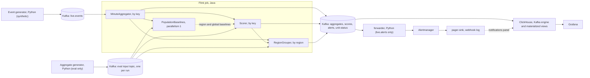

# tenant-baselines Milestone 6 Implementation Plan: README and design doc

> **For agentic workers:** REQUIRED SUB-SKILL: Use superpowers:subagent-driven-development (recommended) or superpowers:executing-plans to implement this plan task-by-task. Steps use checkbox (`- [ ]`) syntax for tracking.

**Budget:** 6–7 hours, against §8's "~3 h". **The spec's ~3 h does not hold.** The design doc alone is 13 sections against 18 spec subsections with a stronger review: about 2 h. §8 also did not count the tests that tie the documents' numbers to the result files (forced by §2's first anti-goal), the change to the freeze guard without which the panels cannot land, the stack run that proves the panels, or a decision on 60-odd follow-up lines. Per task: T0 0.1 h, T1 0.7 h, T2 0.3 h, T3 1.3 h, T4 0.3 h, T5 0.6 h, T6 2.1 h, T7 1.0 h, whole-branch review 0.5 h. About 0.8 h of it is machine time (one `make reset && make smoke`, `make ci` twice, `make test` once); the smoke run overlaps Tasks 4 and 5.

**Goal:** A reader who opens the repo finds a README with the diagram, the quick start, the measured results and the limits; a `docs/design.md` that gives the reason for every choice in the spec and says what a much larger deployment would change; a Grafana dashboard with the three panels the spec still owes; and tests that tie the published numbers to the result files.

**Architecture:** Docs are written by hand, but measured figures enter them as blocks printed by a report script and compared whole by a test. The few figures that sit in prose are on lines tagged with their source and checked token by token. The three new panels read tables the stack already has, plus pager-sink's log through a new `GET /notifications`, so no compose, schema or topic file changes. The Flink job is not changed: HEAD's jar stays the code that produced `docs/results.md` and `docs/performance.md`.

**Tech stack:** unchanged. No new dependency, no new Grafana plugin, no binary file.

**Spec:** `docs/superpowers/specs/2026-11-09-tenant-baselines-design.md` (v2 with its amendments). Milestone 6 is §8 item 6. Read all of it: the design doc explains §1–§7 section by section. Also read `docs/results.md`, `docs/performance.md`, the "Milestone 6" sections of `docs/superpowers/m1-followups.md`, `m2-followups.md` and `m3-followups.md` as they stand after milestone 5's last commit, and the `Ruling` lines of the two ledgers on disk (`.superpowers/sdd/2026-11-12-m4-eval/progress.md`, `.superpowers/sdd/2026-11-12-m5-throughput-delay/progress.md`). The ledgers are not tracked: explain their rulings in the doc's own words and never link to them.

**Precondition:** milestone 5 is merged to `main`. Task 0 checks it and stops otherwise. Work on a branch `m6-docs` cut from `main`.

**API checks done for this plan (2026-11-12):**
- `ctx7`, `/websites/grafana_grafana`: `POST /api/ds/query` takes `from`, `to` and `queries[]`, each with `datasource.uid`, `refId`, `format`, `maxDataPoints`, `intervalMs` and the data source's own fields, and answers `results.<refId>.frames[]` with `schema.fields` and `data.values`. A failed query answers 400 with the error in the body.
- `gh api`: the tags `actions/checkout@v7`, `actions/setup-java@v6` and `astral-sh/setup-uv@v10.3.3`, which `ci.yml` uses, exist.
- **Not confirmed by docs; Task 3 Step 6 reads each on the running stack:** the panel type id `status-history`; that the ClickHouse data source turns a long `(time, key, score)` result of `queryType: timeseries` into one series per key; that ClickHouse's `url()` table function is allowed for the user `tb`; that an anonymous Viewer may call `/api/ds/query`.
- Read from the code (nothing was run): `freeze.MEASURED_PATHS` holds `infra` and `docker-compose.yml`; `eval_report.check_measured_code` refuses a render when a measured path differs from the freeze commit; `test_bench_world.py:47-61` runs the same diff over the tuple; `test_docs.py` pins that `flink-job/pom.xml`, `flink-job/src/main` and `shared/` are unchanged since the freeze; each scenario entry of a summary carries `pages`; the `make ci` Python image has no `git`; `RegionGrouper` reads the aggregates as well as the scorer's alerts (`Pipeline.java:86-87`); `bench_state`'s `per_key_bytes` is the scorer's bytes over all keys.

## Global Constraints

- Everything in the milestone 1–5 plans' Global Constraints still applies.
- **No job code changes.** Nothing under `flink-job/` or `shared/` is edited, tests included. (Java tests changed after the freeze and are on `main`; the freeze diff covers `flink-job/pom.xml`, `flink-job/src/main` and `shared` only.)
- **The measured paths stay byte-identical** (`freeze.MEASURED_PATHS`, unchanged: `infra` whole, `docker-compose.yml`, `scripts/submit-eval.sh`, the job's sources, the ten eval modules), with one exemption that Task 1 adds and states: `infra/grafana/dashboards/`. The only file under `infra/` this milestone edits is `infra/grafana/dashboards/tenant-baselines.json`.
- **No result file is edited by hand:** nothing under `docs/results/` or `docs/performance/`. `docs/results.md` and `docs/performance.md` change only by `make results` and `make performance`.
- **Measured numbers in `README.md` and `docs/design.md` come from `docs/results.md` or `docs/performance.md`.** What the tests enforce: (a) each marker block equals what the report script prints; (b) a line that ends with a source tag carries only numbers found in that file; (c) in `docs/design.md`, outside the blocks, a line with a decimal number or a number of four or more digits must end with a tag, cite a spec section or say `configured` or `estimate` (setting names, ratios, versions and dates aside); (d) in `README.md`, outside `## Results`, every token with a digit is on a short allowlist. What they do not enforce, and the stronger reviewers of Tasks 6 and 7 read for: a small whole number typed into prose, and a figure that sits with the wrong family or run.
- Configured values (20 s, 60 s, 3 minutes, 2 minutes, 50%) are called configured, or cite their spec section. An estimate is labelled an estimate; the extrapolation sits under a heading that says "Extrapolation, not measured".
- **Synthetic data is labelled synthetic** in the first lines of every document, and no sentence claims production use or that a result transfers to real traffic.
- **Repo rules:** name no employers, clients, internal systems or companies; none of the words spearheaded, leveraged, synergy, cutting-edge, results-driven, passionate; plain, short sentences (aim under 25 words, one idea each); Apache-2.0; commit locally after each task; never push, never add a remote, never create a GitHub repo.
- **Docker.** Tasks 0, 1, 2, 5 and 6 need none (`make test-py`, `make lint-py`, `make results`, `make performance`). Task 3 Step 6, Task 4 Step 4 and Task 7 Step 5 do. Before each: `colima status`; if it runs, use it as it is and do not resize it; if it is stopped, `colima start --cpu 8 --memory 10` (the spec's size, §3) and say so. After the last one: `make down`, then `docker ps`; stop Colima only if nothing is left, and say which.
- **The Mac must stay awake during the smoke run** (lid open; `pmset -g ps` read first). A sleep freezes the VM and the job pages on the silence.

## Builder's calls

Each is settled here. None is left for the owner. Calls 9 and 18–24 are the controller's rulings on this plan's review (2026-11-12).

1. **`docs/design.md` has thirteen numbered sections,** listed in Task 6, in the pipeline's order and then the eval's. *A reader follows the data, and each section can cite one spec section.*
2. **It explains every subsection of spec §4, §5 and §6,** and cites each as `spec 4.3`. A test checks all 18 references. *§8 asks for "the reasoning for each choice in this document"; a reference per subsection makes that checkable.*
3. **Sources, in this order:** the spec for the choice and its reason; the ledgers' rulings for where the build decided something the spec left open; the follow-up files for caveats; `docs/results.md` and `docs/performance.md` for every figure.
4. **The world is 48 keys.** The doc says 48, says the spec's §5.2 and §6 say "about 60" and "60", and gives the reason from the milestone 4 ruling. *The code and both result files say 48; the spec's own two sentences give 42.*
5. **The state extrapolation is printed by `bench_report.extrapolation_table(state)`** and pasted into `docs/design.md` under "Extrapolation, not measured"; a test compares the two. It stays in `docs/performance.md` too. *§6 puts it in `design.md`; one function for both stops drift.*
6. **The diagram is one Mermaid `flowchart LR` block,** fixed in Task 6, in `docs/design.md` and repeated in `README.md`; a test compares the two blocks and checks every topic and service name against `create-topics.sh` and `docker-compose.yml`. *Mermaid renders on GitHub and adds no binary; a README without the picture loses the reader who never opens the design doc.*
7. **The three panels are:** a score status-history per region (one row per key, 5-minute cells, coloured at the live setting's resolve and fire levels 2 and 4), a notifications table and a unit-status table. *§4.10 names them; a row per key shows a regional incident as a block and a tenant incident as one line.*
8. **Notifications reach Grafana through `GET /notifications` on pager-sink, read by ClickHouse's `url()` table function inside the panel's query.** *A Kafka topic, a ClickHouse table or a new plugin would each edit a measured path or add a dependency.* **One attempt:** if panel 4's query fails for any reason in Task 3 Step 6, do not debug it. The panel becomes a `text` panel that names `docker compose exec pager-sink cat /data/notifications.jsonl` and the Alertmanager URL, `docs/design.md` says notifications are not in Grafana and why, and `GET /notifications` stays.
9. **`MEASURED_PATHS` keeps `infra` whole. A new `DISPLAY_ONLY_PATHS = ("infra/grafana/dashboards",)` names what the measured-code check ignores.** The guard still refuses any other difference. The Setup line of `docs/results.md` names every display-only file that differs from the freeze commit, and a dated method note says what was exempted, when and why. The change is its own commit. *No measured file reads a dashboard: the eval reads the alerts topic. The guard was changed after the official runs, so the report must say so on its face. The provisioning files under `infra/grafana` stay frozen: this milestone edits neither.*
10. **Everything else in the "compose pass" is not done:** the Alertmanager volume, the `ingest_errors` TTL, `LogAppendTime` on `live.*`, start-order waits. *Each edits `docker-compose.yml` or a measured `infra/` file, and would end the claim that the published numbers come from this tree.* They go to `docs/superpowers/open-items.md` and, where a reader would trip on them, to the README's limits.
11. **The README loses its one-run demo figures** (warm-up seconds, event count, the three page times, the outage times, the TaskManager reading). `scripts/demo.sh` stops printing them, and `bench_report` stops citing them. *They came from one run and no result file holds them. Milestone 5's delay figures replace them.*
12. **The README's performance block is printed by `bench_report.readme_block(...)`** and pasted between two HTML comment markers; a test compares it whole. The eval block keeps milestone 4's sentences and tests. *The sitting has not run when this plan is written, so the plan cannot type the numbers; a rendered block needs none.*
13. **The README does not say whether CI has run on GitHub.** It names the workflow and `make ci`. The milestone report says the workflow has not run. *The sentence would be false after the owner's first push.*
14. **CI gets `uv sync --locked`, `fetch-depth: 0` in the Python job, and one test that the workflow's six commands are `make ci`'s, in order.** Nothing else. *The test ends "kept in sync by hand"; full history lets the freeze pins run on GitHub and not skip. The action tags were checked. Docker is on `ubuntu-latest` for `check-am.sh`. What stays unproven until the first push: the runner's Maven against the `maven:3.10.0` image, and MiniCluster timing on a smaller runner.*
15. **Open items go to one new file, `docs/superpowers/open-items.md`.** The three follow-up files are not marked line by line: one line at the top of each "Milestone 6" section points at this plan's table and at `open-items.md`. *Milestone 6 is the last, so "deferred" needs a place; the table is already committed with the plan.*
16. **The rule test allows a banned word only on a line that holds three or more of them, or in the two report tests that list them.** *A line with three is a statement of the rule; the plans and the spec quote it.*
17. **No rule test for company names or production claims.** *No list of names can be written without naming them, and a phrase list fails on a denial. The reviewers of Tasks 6 and 7 read for both.*
18. **The design doc's measured figures sit in rendered blocks** (the headline table in §9, the README's performance block in §10, the extrapolation table), and prose stays free of them except on tagged lines. *Whole-block comparison checks family and run; token checks cannot.*
19. **Pages per regional outage stay in** (Task 1). *Spec 4.7 asks for the count per scenario.*
20. **`check_dashboard.py` and smoke check 13 stay in.** *They prove the panels on the stack.*
21. **No Java test is added.** The design doc states the drained-unit behaviour from `RegionGrouper.java`; the test goes to `open-items.md`.
22. **The forwarder's body log and the `check_inhibit` traceback go to `open-items.md`.** *No reader sees either.*
23. **A Task 0 stops the milestone unless milestone 5's three result files are valid and `docs/performance.md` re-renders unchanged.**
24. **The stack proof (Task 3 Step 6) runs while Tasks 4 and 5 are built, one after the other.** *They touch nothing the containers mount.* Task 4's `make ci` waits for the smoke run to end and for a clean tree: it shares the VM, and it snapshots the working tree.
25. **The in-repo copy of this plan is named with the date of its first commit.**

## Follow-ups: folded in, open or dropped

"Open" means a line in `docs/superpowers/open-items.md` with the reason given here.

| Source | Item | Decision |
|---|---|---|
| m1 | Alertmanager state on an anonymous volume | **Open** (call 10). README limits: silences do not survive `make down`. |
| m1 | `tb.ingest_errors` has no TTL | **Open** (call 10). |
| m1 | The Python image runs as root | **Open.** *A non-root user needs the `pager-data` volume re-owned, which is a compose change.* Listed under production hardening in the limits. |
| m1 | JobManager and TaskManager do not wait for Kafka | **Dropped:** `make demo` submits after `wait-ready.sh`. |
| m1 | Host Kafka clients try IPv6 first | **Dropped: done.** `kafka_io._CLIENT` sets `broker.address.family=v4`. |
| m1 | `uv sync --locked` in CI and `make ci` | **Folded** (Task 2). |
| m1 | The shaded jar drops bundled LICENSE files | **Open.** *A fix edits `pom.xml` and changes the jar.* README limits: the jar is not published. |
| m1 | The forwarder's batch post hides which entry was rejected | **Open** (call 22). |
| m2 | Band panel: no per-signal units; cold-key lower line | **Folded** (Task 3): the lower line is null when the median is null; the description names each signal's unit. *A repeated panel cannot carry a unit per repeat.* |
| m2 | `demo.sh` give-up timer and refusal on stdout | **Folded** (Task 2). |
| m3 | Live watermark caveats (five) | **Folded** (Task 6 §3). |
| m3 | Unit-status determinism edges (two) | **Folded** (Task 6 §7). |
| m3 | A tenant alert absorbed by two regional alerts keeps one row | **Folded** (Task 6 §7). |
| m3 | A drained unit keeps its first signal and reason | **Folded in the docs** (the panel's description; Task 6 §7, from the code). The test: **open** (call 21). |
| m3 | Extract unit status from `RegionGrouper.java` | **Open.** *Job code.* |
| m3 | No end-to-end run sees a regional alert resolve | **Dropped:** `RegionGrouperResolveTest` covers it; a smoke check would add over 5 minutes after the spike and needs the generator that check 12 stops. |
| m3 | `check_inhibit` prints a traceback while Alertmanager is down | **Open** (call 22). |
| m3 | Cold-bucket resolve of a seasonal volume alert | **Folded** (Task 6 §4). |
| m3 | The nine milestone 4 points for `design.md` | **Folded** (Task 6 §9), each named there. |
| m1, listed in m3 | Tests for non-JSON webhook bodies | **Folded** (Task 3). |
| m3 | The default submit misses jobs in CREATED or INITIALIZING | **Open.** *`make demo` submits once on an empty cluster; a change to `submit-job.sh` needs smoke checks 11 and 12 re-read.* |
| m3 | `make ci` and `ci.yml` kept in sync by hand | **Folded** (Task 2). |
| m3 | The Flink CLI prints `Unknown module: jdk.compiler` | **Dropped:** it comes from the image; one line in the README's notes. |
| m3 | `check-paths.json` timing | **Dropped: done.** The file was re-run; `test_docs.py` asserts `timing_problem` is `None`. |
| m4 review | Cleanups in measured Python modules | **Dropped:** no behaviour changes, and any edit breaks the freeze line. |
| m4 review | A `repro` kind for official seeds | **Open.** README limits: a reader can run dev seeds (`make eval-dev`), not the official runs. |
| m4 review | False-page breakdown script | **Open.** The README keeps "this eval does not measure the split". |
| m4 review | Repo-wide rule test | **Folded** (Task 4). |
| m4 review | Pages per regional outage | **Folded** (Task 1, call 19). |
| m4 review | Test-only leftovers (four) | **Dropped:** no reader sees them and no number depends on them. |
| m4 review | Eval driver and report gaps (seven) | `make eval` starting the stack: **folded** as README wording (the README names `make results`, which needs no Docker). The other six: **open**, one line each. |
| m3, M5 section | Java minors in `ThresholdsFile`, `AggregateJson`, `Scorer.onTimer` | **Open.** *Job code.* |
| m3, M5 section | Connector 5.1.0 | **Open** until it is released; Task 6 §9 states the rerun rule. |
| m3, M5 section | `eval_run` poll overshoot; checkpoint path written twice; `create-topics.sh` keeps old configs | **Open**, one line each. |
| M5 Task 7 | The live job's retained checkpoints | **Open.** `make reset` removes them; the README says so. |
| M5 Task 7 | `live.*` topics stamped with event time | **Open** (call 10). Task 6 §8 states the effect. |
| M5 Task 7 | `PopulationBaselines` sweep; `unit-tenants` removal | **Open.** *Job code.* Task 6 §12 names both. |
| M5 Task 7 | The demo generator's delivery timeout | **Open.** *A change to the live producer's settings wants its own smoke run.* |
| M5 Task 7 | One `make smoke` over `gen_live`'s `take_step` loop | **Folded** (Task 3 Step 6). |
| M5 Task 7 | Offset correction for `watermark-lag.sh` | **Open.** Its header already says the lag is against the host's clock. |
| M5 Task 7 | `make test-java` can flake after a host sleep | **Folded** (Task 7): one line in the README's notes. |
| M5 Task 7 | Extrapolation table into `docs/design.md` | **Folded** (Tasks 5, 6). |
| M5 Task 7 | README performance block | **Folded** (Tasks 5, 7). |

**Rule for a line not in this table** (milestone 5's sitting may add some; Task 0 applies it): if it can be closed by a sentence in `README.md` or `docs/design.md`, it is listed for Tasks 6 and 7. Otherwise it is open, with one line of reason. If milestone 5 listed "raise or re-split the TaskManager's memory", it is open.

## Where the spec, the follow-ups and the code disagree

1. Spec §8.6 asks for Grafana panels; `freeze.MEASURED_PATHS` counts all of `infra/` as measured code, so the dashboard could not change without a refused render (call 9).
2. The follow-ups call milestone 6 a "compose pass"; `docker-compose.yml`, `infra/kafka` and `infra/clickhouse` are measured paths (call 10).
3. Spec §5.2 says "about 60 keys" and §6 "60 keys"; the code and the result files have 48.
4. Spec §4.10 says the notifications panel is Grafana's; notifications exist only in pager-sink's log file, in no table (call 8).
5. The README's demo figures were measured once and are in no result file, against spec §2's first anti-goal; `bench_report.py:391-393` and `scripts/demo.sh:56` point at them (call 11).
6. Spec §6 says time-to-page is "at least about 5 minutes"; the code counts from the start of the first breaching minute. `docs/performance.md` already says so; Task 6 §10 repeats it.
7. Spec §7 says "nothing is pushed, so it can't run on GitHub yet" and asks every report to say so; a README sentence saying so would go stale (call 13).
8. `m1-followups` asks for `broker.address.family=v4`, and `m3-followups` flags `check-paths.json`'s timing; both are already fixed in the tree.
9. Spec §4.7 asks for page counts per regional outage; `docs/results.md` has the count by scenario type only (Task 1).
10. Spec §2 lists `docs/superpowers/` as the owner's decision before publishing; the rule test scans it, and it quotes the banned words (call 16).
11. Spec §4.1's picture has no line from the aggregates to the grouper; the code has one, for the active-tenant rule (the diagram in Task 6 draws it).

## Review Focus

1. **A result file changes after the README or the design doc copied from it.** Expected: `make test-py` fails and names the block or the line. Pinned in Task 5 (`test_performance_md_is_the_render_of_the_result_files`), Task 6 (the three block tests, `test_tagged_lines_carry_only_their_sources_figures`) and Task 7 (`test_the_readme_performance_block_is_the_scripts`).
2. **A stack with no notification yet, or a pager-sink without its log file.** Expected: `GET /notifications` answers 200 with an empty body; the panel shows no rows, not an error; `check_dashboard` run by hand passes, and fails on the empty panel only with `--require-rows`. Pinned in Task 3 (`test_get_notifications_without_a_log_is_empty`, `test_check_allows_an_empty_panel_unless_rows_are_required`).
3. **A checkout without git history, or a machine without `git`** (the `make ci` image has none). Expected: the rule test walks the tree and skips the ignored directories; the freeze pins skip. Pinned in Task 4 (`test_tracked_files_falls_back_when_git_is_missing`, `..._when_git_fails`, and `make ci` at the task's end).
4. **A dashboard file that no longer loads, or a panel whose query fails.** Grafana then shows an old dashboard or a red panel and nothing else fails. Expected: the static test fails on the file; smoke check 13 fails naming the panel. Pinned in Task 3 (`test_dashboard.py`, `test_check_reports_a_query_error`).
5. **A measured figure typed into a document outside its blocks.** Expected: in the README, the test fails and prints the token; in the design doc, a decimal or a long number on an untagged line fails. Pinned in Task 7 (`test_no_number_outside_the_results_section_but_the_allowed_ones`) and Task 6 (`test_untagged_lines_carry_no_measured_looking_number`). A small whole number in the design doc's prose passes the tests; the stronger reviewer reads for it.

## File map

```
py/src/tenant_baselines/
  freeze.py (modify, Task 1)            DISPLAY_ONLY_PATHS
  eval_report.py (modify, Task 1)       measured_code_diff, the Setup line, the dated note; pages per outage
  pager_sink.py (modify, Task 3)        flatten, COLUMNS, GET /notifications
  check_dashboard.py (new, Task 3)      Grafana serves the panels and each query answers
  bench_report.py (modify, Task 5)      extrapolation_table, readme_block, two print flags, one sentence
py/tests/
  test_eval_report.py test_bench_world.py (Task 1)  test_pager_sink.py (Task 3)
  test_bench_report.py test_docs.py (Tasks 5, 7)
  test_ci_sync.py (Task 2)  test_dashboard.py test_check_dashboard.py (Task 3)
  test_repo_rules.py (Task 4)  test_design_doc.py (Task 6)
infra/grafana/dashboards/tenant-baselines.json                   (Task 3)
scripts/demo.sh  Makefile  .github/workflows/ci.yml (Task 2)   scripts/smoke.sh (Tasks 2, 3)
docs/results.md (re-rendered, Tasks 1, 7)   docs/performance.md (re-rendered, Task 5)
docs/design.md (new, Task 6)   README.md (Task 7)
docs/superpowers/open-items.md (new, Task 0)   docs/superpowers/m{1,2,3}-followups.md (Task 0)
```

**Implementer and reviewer levels.** Every task: standard implementer, except Task 6, which gets the stronger one: it is 400 lines of claims. **Stronger reviewer** for Task 1 (it changes what the freeze guard compares), Task 6 (every reason against the spec, every number against its source, every untagged number) and Task 7 (the README is what most readers see; every sentence that carries a figure or a claim). **Standard reviewer** for Tasks 0, 2, 3, 4 and 5; Task 5's reviewer checks each cell of `readme_block` against the JSON key it reads. The whole-branch review at the end is the stronger one.

---

### Task 0: Milestone 5 is in, and the follow-ups have a place

**Implementer:** standard. **Reviewer:** standard. No Docker.

**Files:** Create `docs/superpowers/plans/<date of this commit>-m6-readme-design.md` (this plan), `docs/superpowers/open-items.md`. Modify `docs/superpowers/m1-followups.md`, `m2-followups.md`, `m3-followups.md`.

- [ ] **Step 1: Check milestone 5. Any failure: stop, report, do nothing else.**
  - On `main`: `git merge-base --is-ancestor m5-bench main` exits 0 (skip if the branch was deleted; the next checks stand in).
  - `docs/performance/throughput.json`, `delay.json` and `state.json` exist, and each has `"valid": true` and `"data": "synthetic"`.
  - `make performance && git diff --exit-code docs/performance.md` → no change.
  - `grep -c "milestone 5 of 6" README.md` → 1.
  - `git status --short` → empty.
- [ ] **Step 2: Branch and copy the plan.** `git switch -c m6-docs`; copy this plan to `docs/superpowers/plans/` under the date of today's commit.
- [ ] **Step 3: Read the follow-up files as milestone 5 left them.** For every line under a "Milestone 6" heading, and every line milestone 5 marked `moved to milestone 6`, that this plan's table does not cover: apply the rule under the table.
- [ ] **Step 4: Write `docs/superpowers/open-items.md`.** First line: planning material; nothing in it blocked a milestone. Then one line per "open" row of the table and per line Step 3 sent here, each with its reason, under `## Job code`, `## Compose and infra (measured paths)`, `## Eval driver and report`, `## Scripts and tests`. Last, a section `## To state in the documents (removed in Task 7)`: the lines Step 3 found that a sentence closes, each with the document and section that will carry it. Write "none" if there are none.
- [ ] **Step 5: Point the follow-up files at the decisions.** Under each "Milestone 6" heading in the three files, add one first line: "Decided in the milestone 6 plan's follow-up table (`docs/superpowers/plans/<file>`). What stays open is in `open-items.md`." Change nothing else in them.
- [ ] **Step 6: Commit.** `git add docs/superpowers && git commit -m "Add the milestone 6 plan and the list of open items"`

### Task 1: The dashboard file may differ from the freeze, and pages per regional outage

**Implementer:** standard. **Reviewer:** stronger.

**Files:** Modify `py/src/tenant_baselines/freeze.py`, `py/src/tenant_baselines/eval_report.py`, `py/tests/test_eval_report.py`, `py/tests/test_bench_world.py`; re-render `docs/results.md`.

**Interfaces (produces):**
- `freeze.DISPLAY_ONLY_PATHS = ("infra/grafana/dashboards",)`, beside `MEASURED_PATHS`, which does not change. Comment: "Added <the commit's date>, after the official runs. A file under these may differ from the freeze commit: the eval reads the alerts topic, and no run reads a dashboard. The report names each such file."
- `eval_report.measured_code_diff(freeze_commit: str) -> list[str]`: `git diff --name-only <commit> HEAD -- <MEASURED_PATHS>`, sorted. It replaces `measured_code_equal`; It raises `RuntimeError` on any non-zero exit of `git` (`--name-only` exits 0 whether or not paths differ; today's check allows 1).
- `eval_report.display_only(paths: list[str]) -> bool`: true when every path is under a `DISPLAY_ONLY_PATHS` entry (an empty list is true).
- `eval_report.check_measured_code(differing: list[str], run_log: list[dict]) -> None`: returns when `display_only(differing)`, or when the run log has a `bug:` entry, as today; raises the same `ValueError` otherwise, with the offending paths in the message.
- `rendered["measured_code_diff"]: list[str]` replaces `rendered["measured_code_equal"]`. The Setup line reads `Measured code at the render commit equals the freeze commit: yes` for an empty list; `yes, except display-only files: <paths joined by ", ">` when `display_only`; `no` otherwise.
- A new method note, after "What check-paths shows": `- **Measured code.** Changed <the commit's date>, after the official runs: the dashboard files under infra/grafana/dashboards may differ from the freeze commit, and the Setup line names each one that does. The dashboards only draw; the eval reads pages from the alerts topic. Everything else under infra/, and docker-compose.yml, is still compared.` The date is a constant in `eval_report`, not the render's date.
- `eval_report.outage_rows(...)`: each family's entry gains `"pages": int`, from the scenario entry's `pages`. The outage table's cell ends with `, <n> pages` (`, 1 page` for one), after `, regional alert` when that is there.

- [ ] **Step 1: Write the failing tests for the guard** in `test_eval_report.py`
  - `test_display_only`: `[]` → true; `["infra/grafana/dashboards/tenant-baselines.json"]` → true; `["infra/grafana/provisioning/datasources/clickhouse.yml"]` → false; `["infra/grafana/dashboards/x.json", "docker-compose.yml"]` → false.
  - `test_measured_code_diff_raises_when_git_fails`: a fake `subprocess.run` that exits 1 and one that exits 128 → `RuntimeError` both times.
  - `test_check_measured_code_allows_only_display_files`: the dashboard path alone returns; with `infra/kafka/create-topics.sh` added it raises `ValueError` naming that path; the same list with a `bug:` run-log entry returns.
  - `test_setup_line_names_display_only_files`: the three renders give `: yes`, `: yes, except display-only files: infra/grafana/dashboards/tenant-baselines.json` and `: no`. Update every use of the old name in `test_eval_report.py`: the `rendered` dict at `:610` (`"measured_code_diff": []`), the assertion at `:620`, the `no` case at `:621` (a non-display path in the list), and the `repo` fixture at `:646`, which must monkeypatch `eval_report.measured_code_diff` to return `[]` (`monkeypatch.setattr` raises on the removed attribute).
  - `test_method_notes_date_the_change`: the render contains `Changed ` + the constant date + `, after the official runs` and `Everything else under infra/, and docker-compose.yml, is still compared.`
  - `test_no_measured_file_reads_grafana`: no file that is, or is under, a `MEASURED_PATHS` entry contains `grafana` (case-insensitive), apart from `docker-compose.yml` and the files under `infra/grafana/`.
  - `test_bench_world.py::test_measured_paths_equal_the_freeze`: replace the direct `git diff --quiet` with `assert eval_report.display_only(eval_report.measured_code_diff(commit))`. Import `eval_report` there. Keep its skips.
- [ ] **Step 2: Run them.** `make test-py` → five of the six fail (the repointed bench-world pin too); `test_no_measured_file_reads_grafana` passes (a pin).
- [ ] **Step 3: Implement the guard.** `make test-py && make lint-py` → clean.
- [ ] **Step 4: Commit it alone.** `git add py/src/tenant_baselines/freeze.py py/src/tenant_baselines/eval_report.py py/tests/test_eval_report.py py/tests/test_bench_world.py && git commit -m "Allow the Grafana dashboard file to differ from the freeze commit, and say so in the results"`
- [ ] **Step 5: Pages per outage, test first.** `test_outage_cell_carries_its_page_count`: with the existing outage fixture's `pages` set to 3 and to 1, the rendered rows contain `regional alert, 3 pages` and `, 1 page |`. Run → fails. Implement. `make test-py && make lint-py` → clean. `git add py/src/tenant_baselines/eval_report.py py/tests/test_eval_report.py && git commit -m "Print the page count of each regional outage"`
- [ ] **Step 6: Render.** `make results` (no Docker). Read `git diff docs/results.md`. Expected: the `Rendered at commit` line; 5 rows of the regional-outage table, each cell longer by its page count; one new method note; the Setup line still `: yes`. **No other line may change.** If a headline, sweep, setting or scenario cell changed, stop and report: that is a bug in this task, not a result.
- [ ] **Step 7: Check and commit.** `make test-py` → clean. `git add docs/results.md && git commit -m "Render the results with pages per outage and the measured-code note"`

### Task 2: CI sync and the demo script

**Implementer:** standard. **Reviewer:** standard.

**Files:** Create `py/tests/test_ci_sync.py`. Modify `.github/workflows/ci.yml`, `Makefile`, `scripts/demo.sh`, `scripts/smoke.sh`.

- [ ] **Step 1: Write the failing test.** `test_ci_sync.py::test_make_ci_runs_the_workflows_commands_in_order`: the values of the `- run:` lines of `ci.yml`, in order (a regex over the text; there is no YAML dependency), equal `["mvn -B verify", "uv sync --locked", "uv run ruff check .", "uv run ruff format --check .", "uv run pytest -q", "scripts/check-am.sh"]`; and the Makefile's `ci` recipe (the lines after `ci:` up to the next blank line) contains each of the six, at rising positions.
- [ ] **Step 2: Run it.** `make test-py` → fails on `--locked`.
- [ ] **Step 3: Implement.**
  - `ci.yml`: `uv sync --locked`; under the Python job's checkout, `with: fetch-depth: 0`, with the comment "Full history: the tests that compare the tree with the freeze commit skip without it." Change nothing else.
  - `Makefile` `ci`: `uv sync --locked`.
  - `scripts/demo.sh`: the "needs an empty stack" refusal (line 51) goes to stderr; lines 55–56 ("Warm-up took 235 s in the measured run …") become "Warm-up takes a few minutes."; the warm-up deadline is `start + WARMUP_TIMEOUT_S`, with `start` the script's own start, not the submit; the last four `echo` lines (147–150, page times measured once) become `echo "Measured delays, on synthetic data: docs/performance.md."`.
  - `scripts/smoke.sh` line 15: "about 24.3 million events" becomes "its three weeks of history" (once; the sentence already says so).
- [ ] **Step 4: Run.** `make test-py && make lint-py` → clean. `bash -n scripts/demo.sh scripts/smoke.sh` → no output. `grep -n -E '235|389|390|327|24\.3' scripts/demo.sh scripts/smoke.sh` → no output.
- [ ] **Step 5: Commit.** `git add .github/workflows/ci.yml Makefile scripts/demo.sh scripts/smoke.sh py/tests/test_ci_sync.py && git commit -m "Tie make ci to the workflow; lock uv sync; drop the demo script's one-run figures"`

The scripts are exercised by Task 3's smoke run.

### Task 3: The three Grafana panels

**Implementer:** standard. **Reviewer:** standard.

**Files:**
- Modify: `py/src/tenant_baselines/pager_sink.py`, `py/tests/test_pager_sink.py`, `infra/grafana/dashboards/tenant-baselines.json`, `scripts/smoke.sh`
- Create: `py/src/tenant_baselines/check_dashboard.py`, `py/tests/test_check_dashboard.py`, `py/tests/test_dashboard.py`

**Interfaces (produces):**
- `pager_sink.COLUMNS: tuple[str, ...]` = `("received_at", "receiver", "status", "alertname", *forwarder.LABEL_FIELDS, "starts_at", "ends_at")`. *The import ties the stand-in pager to the forwarder's module; accepted, since the columns are the forwarder's labels.*
- `pager_sink.flatten(record: dict) -> list[dict]`: one row per entry of `record["body"]["alerts"]`, with exactly the keys of `COLUMNS`, every value a string: `received_at` and `receiver` from the record, `status`, `startsAt` and `endsAt` from the alert, the rest from its `labels`, `""` where one is missing. A record whose body is not an object, or has no `alerts` list, gives `[]`.
- `GET /notifications` on pager-sink: 200, `Content-Type: application/x-ndjson`, the flattened rows of the log's last 500 records, one JSON object per line, oldest first. No log file: 200 and an empty body. Any other GET path: 404. `POST` is unchanged. It reads the whole log on each call; that is fine for a demo, and Task 6 §8 says so.
- `check_dashboard.substitute(sql: str, values: dict[str, str]) -> str`: replaces `${name}` for each name.
- `check_dashboard.check(grafana: str = "http://localhost:3000", path: Path = <the dashboard file>, require_rows: bool = False, get=httpx.get, post=httpx.post) -> list[str]`: the problems, empty when all is well.
  1. `GET <grafana>/api/dashboards/uid/tenant-baselines`: the served panels' titles equal the file's (a repeated panel counts once).
  2. Values: `key` and `region` are the first row of their variable's query, sent through `POST /api/ds/query`; `signal` is `error_rate`.
  3. For each panel target with a `rawSql`: `POST /api/ds/query` with `{"from": "now-3h", "to": "now", "queries": [{**target, "rawSql": substitute(...), "intervalMs": 60000, "maxDataPoints": 500}]}`. A status other than 200, or an `error` in the result, is one problem naming the panel's title. Frames with no row are a problem only when `require_rows`.
- `check_dashboard.main()`: `--require-rows`. Prints each problem and exits 1, or prints `dashboard OK: <n> panels`. Without the flag it adds: "empty panels are allowed; the notifications and unit-status panels fill after the first page and the first drain".
- Dashboard `tenant-baselines`: panels 1 and 2 keep their ids; new ids 3, 4 and 5; a new variable `region`.

**The dashboard, exactly:**
- Variable `region`: type `query`, `SELECT DISTINCT region FROM tb.scores WHERE ns = 'live' ORDER BY region`, `multi` and `includeAll` true, `hide: 2`, built like `signal` so a panel can repeat over it.
- Panel 1: `lower` becomes `if(isNull(median), NULL, greatest(median - 4 * spread, 0))`. The description gains: "Units: error_rate is a fraction of requests, latency_p95 is milliseconds, volume_5m is requests in 5 minutes."
- Panel 3, type `status-history`, title `Score by key: $region`, `repeat: "region"`, direction `v`:
  ```sql
  SELECT toStartOfInterval(minute, INTERVAL 5 minute) AS time, key, max(score) AS score
  FROM tb.scores FINAL
  WHERE ns = 'live' AND region = '${region}' AND minute >= $__fromTime AND minute <= $__toTime
  GROUP BY time, key ORDER BY time, key
  ```
  `queryType: timeseries`, `format: 0`. Thresholds, absolute: base green, 2 yellow, 4 red. Description: "Synthetic demo data. One row per key. Each cell is the highest score of the key's three signals in 5 minutes, against the live seasonal setting: yellow from 2 (the resolve level), red from 4 (the fire level). A regional incident shows as a block; one tenant's as one row."
- Panel 4, type `table`, title `Notifications (latest 100, from pager-sink)`:
  ```sql
  SELECT parseDateTime64BestEffort(received_at, 3, 'UTC') AS received, * EXCEPT (received_at)
  FROM url('http://pager-sink:8099/notifications', 'JSONEachRow', '<structure>')
  ORDER BY received DESC LIMIT 100
  ```
  `<structure>` is `", ".join(f"{c} String" for c in pager_sink.COLUMNS)`, typed into the file. Description: "Synthetic demo data. What Alertmanager sent to the stand-in pager, one row per alert in each notification. Read from pager-sink's log over HTTP, not from a table."
- Panel 5, type `table`, title `Unit status (live)`:
  ```sql
  SELECT unit, region, argMax(status, at) AS last_status, argMax(signal, at) AS last_signal,
         argMax(reason, at) AS last_reason, max(at) AS since
  FROM tb.unit_status FINAL
  WHERE ns = 'live'
  GROUP BY unit, region ORDER BY since DESC
  ```
  Description: "Synthetic demo data. Published only: nothing acts on a drain. A drained unit keeps the signal and reason it was first drained for until it undrains. Volume alerts never drain a unit, and no unit is drained during a regional alert." Before writing the second sentence, read `RegionGrouper.java`'s unit-status code; if it does something else, write what it does and say so in the task report.
- The dashboard's `description` names all five panels and keeps "Synthetic demo data". Layout: panel 3 under the alert log, full width, `h: 8`; panels 4 and 5 side by side under it, `w: 12`, `h: 10`.

- [ ] **Step 1: Write the failing tests**
  - `test_pager_sink.py`:
    - `test_flatten_gives_one_row_per_alert`: a record with two alerts (one `firing` with labels `alertname`, `scope`, `region`, `signal`; one `resolved` with an `endsAt`) → two rows, keys exactly `COLUMNS`, `rows[1]["status"] == "resolved"`, a missing label is `""`.
    - `test_flatten_ignores_a_body_that_is_not_an_object`: body `"plain text"` and body `{"x": 1}` → `[]`.
    - `test_post_with_a_non_json_body_is_logged_as_text` *(the m1 follow-up)*: POST `b"not json"` → 200, and the log line's `body` is `"not json"`.
    - `test_get_notifications_returns_the_flattened_log`: after two POSTs, `GET /notifications` → 200, each line `json.loads` to a dict with keys `COLUMNS`.
    - `test_get_notifications_without_a_log_is_empty`: a server whose log path does not exist → 200, body `b""`.
    - `test_get_notifications_keeps_the_last_500_records`: 510 POSTs of one alert each → 500 lines, the first of them the 11th POST.
    - `test_get_of_another_path_is_404`.
  - `test_dashboard.py` (reads the file; no stack):
    - `test_panels`: ids `[1, 2, 3, 4, 5]`; types `timeseries`, `table`, `status-history`, `table`, `table`; the three new titles as above.
    - `test_every_query_reads_the_live_namespace_deduplicated`: every `rawSql` that names a `tb.` table contains `ns = 'live'` and `FINAL`.
    - `test_notifications_structure_is_the_sinks_columns`: panel 4's `rawSql` contains `http://pager-sink:8099/notifications` and the structure string built from `pager_sink.COLUMNS`; `8099` is the port in `docker-compose.yml`'s pager-sink command.
    - `test_every_description_says_synthetic`: the dashboard's and panels 1, 3, 4 and 5's descriptions contain `ynthetic`.
    - `test_variables`: names `key`, `signal`, `region`; every `${...}` in any `rawSql` is one of them.
    - `test_cold_key_lower_line_is_null`: panel 1's `rawSql` contains `isNull(median)`.
    - `test_not_editable`: `editable` is false; `uid == "tenant-baselines"`.
  - `test_check_dashboard.py` (fake `get` and `post`):
    - `test_substitute`: `"a '${key}' ${signal}"` with both values.
    - `test_check_passes`: served titles equal the file's, every query answers one frame with rows → `[]`.
    - `test_check_reports_a_missing_panel`: the served dashboard lacks `Unit status (live)` → one problem naming it.
    - `test_check_reports_a_query_error`: a 400 whose body holds `"error": "Code: 62"` for panel 4 → a problem with the title and `Code: 62`.
    - `test_check_allows_an_empty_panel_unless_rows_are_required`: frames with empty `values` → `[]`; with `require_rows=True` → a problem with the title and `no rows`.
- [ ] **Step 2: Run them.** `make test-py` → the new tests fail.
- [ ] **Step 3: Implement** the sink, the checker and the dashboard file. Keep the JSON's two-space layout and key order.
- [ ] **Step 4: Add smoke check 13** to `scripts/smoke.sh`: `check_dashboard() { (cd py && uv run python -m tenant_baselines.check_dashboard --require-rows); }`, labelled "13 Grafana serves the five panels and each returns rows". It runs once, after checks 9 and 10 and before check 11; checks 6 and 8 have then seen a page and a drain. Two more changes make it runnable: add 13 to `ALL_CHECKS` (`smoke.sh:29`), which the validation loop reads, and add `if wanted 13; then check_dashboard; fi` between the `wanted 10` and `wanted 11` lines (`:340-341`). Then change every "1 to 12" and "all 12" in the script's messages and header to 13.
- [ ] **Step 5: Run and commit.** `make test-py && make lint-py` → clean. `bash -n scripts/smoke.sh`. `git add py/src/tenant_baselines/pager_sink.py py/src/tenant_baselines/check_dashboard.py py/tests/test_pager_sink.py py/tests/test_dashboard.py py/tests/test_check_dashboard.py infra/grafana/dashboards/tenant-baselines.json scripts/smoke.sh && git commit -m "Add the score, notifications and unit-status panels, and a smoke check for them"`
- [ ] **Step 6 (needs Docker, about 40 minutes; lid open): prove it on the stack.** The controller starts this step and, while it runs, dispatches Task 4 (Steps 1–3 only) and then Task 5, one after the other, never side by side; they edit only `py/tests`, `bench_report.py` and `docs/performance.md`, none of which a container mounts. Nothing else uses Docker until the smoke run prints its last line. Follow the Docker rule. Then `make reset && make smoke`. Expected: `PASS` for all 13 checks. This run also covers Task 2's script changes and `gen_live`'s `take_step` loop. After check 8 passes, open `http://localhost:3000/d/tenant-baselines` and look at the five panels once. Three branches, each decided:
  - **Panel 3 shows one row, not one per key:** the data source returned a long frame. Add `"transformations": [{"id": "partitionByValues", "options": {"fields": ["key"]}}]` to panel 3 and assert it in `test_dashboard.py`.
  - **Panel 4's query fails, for any reason:** one attempt only (call 8). Panel 4 becomes type `text`; `test_dashboard.py` follows; `check_dashboard` skips a panel with no target.
  - **Grafana does not know `status-history`:** use type `heatmap` with the same query and `"calculate": false`; update the test.

  After a branch, run `CHECKS=13 scripts/smoke.sh` on the same stack → `PASS 13`. A `FAIL 13` in the main run, followed by a branch and `PASS 13` from this rerun, counts as passed; say so in the report. Then `make down`, unless Task 4's `make ci` is still running. One commit for any change, staged by file name: `git commit -m "Match the panels to what the running stack returns"`. Record in the task report which branches applied; Task 6 §8 needs it.

### Task 4: The repo-wide rule test

**Implementer:** standard. **Reviewer:** standard.

**Files:** Create `py/tests/test_repo_rules.py`.

**Interfaces (produces):**
- `BANNED = ("spearheaded", "leveraged", "synergy", "cutting-edge", "results-driven", "passionate")`.
- `tracked_files(repo: Path = REPO, run=subprocess.run) -> list[Path]`: the output of `git ls-files` when `git` runs and exits 0. **When `git` is missing (`run` raises `FileNotFoundError`) or exits non-zero,** every file under `repo` outside directories named `.git`, `target`, `.venv`, `__pycache__`, `.pytest_cache`, `.ruff_cache`, `data`, `.idea`, `.superpowers`. Files that do not decode as UTF-8 are left out.
- `SYNTHETIC_DOCS: list[str]` = `["README.md", "docs/results.md", "docs/performance.md"]`. Task 6 appends `"docs/design.md"`.

- [ ] **Step 1: Write the tests**
  - `test_no_banned_words_outside_statements_of_the_rule`: for every tracked file and line, lower-cased: a line with one or two `BANNED` words fails, unless the file is `py/tests/test_bench_report.py`, `py/tests/test_eval_report.py` or this test. The failure message lists `path:line`.
  - `test_the_rule_allows_only_lines_that_state_it`: over a `tmp_path` tree, a line built in the test from `BANNED[1]` and `BANNED[2]` fails, a line with `BANNED[0]` alone fails, and a line with all six passes. Build the lines from `BANNED`; do not type them.
  - `test_tracked_files_falls_back_when_git_is_missing`: a fake `run` that raises `FileNotFoundError`, over a `tmp_path` tree with `a.md`, `target/x.class` and `.venv/y.py` → only `a.md`.
  - `test_tracked_files_falls_back_when_git_fails`: a fake `run` that exits 128 → the same.
  - `test_documents_say_synthetic_at_the_top`: each of `SYNTHETIC_DOCS` has `synthetic` (any case) in its first 12 lines.
  - `test_result_files_are_labelled_synthetic`: every `docs/results/summaries/*/summary.json` has `synthetic is True` and `meta["data"] == "synthetic"`; every `labels.json` has `meta["data"] == "synthetic"`; every `docs/performance/*.json` has `data == "synthetic"`; `docs/results/check-paths.json`'s `world` and `eval/freeze.json`'s `note` contain `synthetic`.
- [ ] **Step 2: Run them.** `make test-py`. They are pins: each should pass on the tree as it is. For each that fails, fix the file it names (a label, a word), not the test, unless the hit is a statement of the rule the test should allow.
- [ ] **Step 3: Show the word test has teeth.** Add a line holding the second word of `BANNED` to `README.md`, run `make test-py` → `test_no_banned_words_outside_statements_of_the_rule` fails naming `README.md`. Remove the line; run again → clean.
- [ ] **Step 4 (needs Docker): run it where there is no git.** Only after Task 3's smoke run has printed its last line, and with a clean tree (`git status --short` empty; `make ci` copies the working tree, so no other task may be mid-edit): `make lint-py`, then `make ci` → green. Its Python image has no `git`, so this is the fallback's real test.
- [ ] **Step 5: Commit** (after Step 3; Step 4 may follow the commit, and Task 5's). `git add py/tests/test_repo_rules.py && git commit -m "Check the banned words and the synthetic label over the tracked tree"` (add any file Step 2 fixed).

### Task 5: The two blocks the documents copy from the performance files

**Implementer:** standard. **Reviewer:** standard, checking each cell against its JSON key.

**Files:** Modify `py/src/tenant_baselines/bench_report.py`, `py/tests/test_bench_report.py`, `py/tests/test_docs.py`; re-render `docs/performance.md`.

**Interfaces (produces):**
- `bench_report.extrapolation_table(state: dict) -> str`: the Markdown table that `_extrapolation` prints today, and nothing else. `_extrapolation` calls it.
- **One sentence of `_delay` changes** (`bench_report.py:391-393`): "The README's milestone 3 page times were measured at the webhook, from the incident's start minute, and are not comparable." becomes "Page times read at the webhook include the forwarder and `group_wait`, and are not comparable." No other output of `render(...)` changes.
- `bench_report.readme_block(throughput: dict, delay: dict, state: dict) -> str`: runs `check_results` first, then returns exactly this table, every value from the files, formatted by the module's own `n` and `count`:

  ```
  | Measurement (synthetic data, one laptop) | Figure |
  |---|---|
  | Sustained throughput of the live job, <fill.keys> keys | <events_per_s of each run, joined by " and "> events a second (<len(runs)> runs) |
  | Pipeline delay, <headline.detector>/<headline.setting> | p50 <p50> s, p95 <p95> s (n=<n>) |
  | Time to page, incident start to the alerts topic | p50 <p50> s, p95 <p95> s, minimum <min> s (n=<n>) |
  | Watermark lag during the delay run | median <median> s (<min> to <max>) |
  | Scorer state per key, mean over <keys> keys after <world.weeks> replayed weeks (<headline_backend>) | <per_key_bytes> bytes |
  ```
  Sources: `throughput["fill"]["keys"]`, `throughput["runs"][i]["events_per_s"]` (0 decimals); `delay["headline"]["pipeline_delay_s"]` and `["time_to_page_s"]` (`p50`, `p95`, `min`, `n`); `delay["watermark_lag_s"]`; `state["world"]["weeks"]`; the `state["runs"]` entry whose `backend` is `state["headline_backend"]`: its `keys` and `per_key["per_key_bytes"]` (0 decimals).
- `main()`: `--readme-block` prints `readme_block(...)` and `--extrapolation-table` prints `extrapolation_table(...)`; each exits without writing a file.

- [ ] **Step 1: Write the failing tests**
  - `test_bench_report.py::test_readme_block_carries_the_fixtures_figures`: with the fixtures' distinctive values (123,457; 98.7; 263.4; 23.9; 765,432), each appears in `readme_block(...)`; the block has 7 lines; it contains `synthetic`; its last row contains `mean over 48 keys` and the fixture's `weeks`, and does not contain `4-week`.
  - `test_readme_block_refuses_an_invalid_result`: `valid: false` → `ReportRefused`.
  - `test_extrapolation_table_is_inside_the_render`: `extrapolation_table(state) in render(...)`, and the line `## Extrapolation, not measured` comes before it.
  - `test_the_delay_section_does_not_point_at_the_readme`: `README` is not in `_delay(...)`'s output; `Page times read at the webhook` is. (No existing test pins the old sentence.)
  - `test_docs.py::test_performance_md_is_the_render_of_the_result_files`: `bench_report.render(<the three files under docs/performance>).strip() == (REPO / "docs/performance.md").read_text().strip()`.
- [ ] **Step 2: Run them.** `make test-py` → the first four fail; the fifth passes (Task 0 checked it).
- [ ] **Step 3: Implement.** The fifth test now fails, until the next step.
- [ ] **Step 4: Render.** `make performance`. `git diff docs/performance.md` → exactly one changed line, the webhook sentence. Anything else: stop and report.
- [ ] **Step 5: Run and commit.** `make test-py && make lint-py` → clean. `git add py/src/tenant_baselines/bench_report.py py/tests/test_bench_report.py py/tests/test_docs.py docs/performance.md && git commit -m "Print the README's performance block and the extrapolation table from the result files"`

### Task 6: `docs/design.md`

**Implementer:** stronger. **Reviewer:** stronger.

**Files:** Create `docs/design.md`, `py/tests/test_design_doc.py`. Modify `py/tests/test_repo_rules.py` (append `"docs/design.md"` to `SYNTHETIC_DOCS`).

**Rules of the document**
- About 400 lines. One paragraph or bullet per line, as `docs/results.md` is written. Short sentences. Each choice is stated, then its reason, then what it costs.
- Mark who decided: "(owner's call)" or "(builder's call)", as the spec does.
- **Measured figures come in three blocks, pasted unchanged between HTML comment markers:**
  - `<!-- headline:begin -->` … `<!-- headline:end -->` in §9: the README's three-row eval table (family, pooled expected-signal recall, pooled false pages per day), copied from the headline table of `docs/results.md`.
  - `<!-- performance:begin -->` … `<!-- performance:end -->` in §10: the output of `cd py && uv run python -m tenant_baselines.bench_report --readme-block`.
  - `<!-- extrapolation:begin -->` … `<!-- extrapolation:end -->` in §10: the output of `… --extrapolation-table`.
- **Prose refers to the blocks and carries no figure of its own,** with these exceptions, each on a line that ends with its source tag, `([results](results.md))` or `([performance](performance.md))`: matched pages over all pages per family; pages per detected regional outage; the cold-start burst's recall; the world's counts. Every number on a tagged line must appear, character for character, in that file. Copy; do not round or recompute.
- A line with a decimal number or a number of four or more digits, outside the blocks and the diagram, must end with a tag or match `\bspec \d` (a spec citation), `\bconfigured\b` or `\bestimate`. Removed before the check, since none can be a measured figure: dates, `FLINK-39728`, versions (`5.1.0`, `5.0.0-2.2`), setting names (`p99.9`) and ratios (`1.5:1`). A heading loses only its leading section number; the rest of it is checked.
- No link into `.superpowers/`. Links to the spec, the plans, `results.md` and `performance.md` are relative and must resolve.
- State only what the code shows. Where this plan gives a fact about the code, check it in the file named before writing it.

**Sections, in this order, with their sources.** Headings are exactly `## <n>. <title>`.

1. **What this is.** Spec §1 and §2. Synthetic data, one laptop, no claim about any real system; the claim under test; what the eval can and cannot show; how to read the doc (calls, blocks, tags, "configured").
2. **Architecture.** The diagram below, in a `mermaid` fence. Then spec 4.1: namespaces, the key and why a dedicated unit's key is the tenant's own baseline, the two input modes and what they share. One sentence on the line the spec's picture lacks: the grouper also reads the minute aggregates, to know which tenants are active.
3. **Events, watermarks and minute aggregates.** Spec 4.2. Why a keyed process function and not a window; zero-fill; the end-of-input guard; late events counted, not re-aggregated; key expiry on event time because state TTL counts processing time. The live watermark: the tick source and the 2026-11-11 amendment's reason. Then a list headed "Where the live watermark can lose data", with all five m3 caveats: producers' clocks more than about 20 s (configured) behind the TaskManager's after a silence; a forward step of the TaskManager's clock while partitions are idle; producers that buffer over 60 s (configured); a bare `submit-job.sh` on empty partitions (only `make demo` waits; `lateEvents` is the only sign); idleness as a wall-clock guess after a restore. The measured lag is in §10's block; a sparse partition was not measured. The clock step-back after a host sleep (m3).
4. **The seasonal baseline.** Spec 4.3. Hour-of-week buckets, 4 weeks, median and MAD and why robust; every minute feeds it (owner's call 6) and what that costs; each signal's spread floor with its reason; the 5-minute volume sum; the zero-traffic rule; minimum evidence and the pause rule; caching. Known limits: within-hour ramps, UTC buckets and DST, a lasting problem absorbed in about two weeks. **Cold-bucket resolve** (m3): a firing seasonal volume alert resolves on entering a cold bucket and re-fires in the next warm one; no eval world has a key with warm and cold volume buckets at once.
5. **Cold start.** Spec 4.4. Region then global for error rate and latency; volume waits; `PopulationBaselines` at parallelism 1 with histograms; why a broadcast a week ahead cannot race. The cold-start burst has no volume rule and can land in minutes the seasonal detector does not score; its recall row, tagged.
6. **Fire, resolve and the static opponents.** Spec 4.5 and 4.6. What all three families share and why that isolates the baseline; deterministic alert ids; thresholds fitted outside the job and why; calibration that favours the opponent; the mask and its 2026-11-12 amendment (every labelled scenario but the Monday peak, to 4 minutes past its end); the settings grids. **The inclusive fire comparison** (milestone 4 ruling): values are discrete, so a static threshold is breached on calibration minutes more often than its nominal percentile; it was not changed, and why.
7. **Regional grouping and unit status.** Spec 4.7 and 4.8. Hold, promote, absorb, regional resolve, re-hold; alerts already sent stay sent, and the inhibit rule as backstop; night outages, with pages per detected regional outage, tagged. Unit status is published only; the drain rules and why volume never drains. Then, from m3: what a drained unit keeps until it undrains, read from `RegionGrouper.java` (no test pins it; say so); a tenant alert absorbed by two regional alerts writes two `absorbed` events with one `(alert_id, state)` and the table keeps the later; the two determinism edges, with the sentence that both touch only `tb.unit_status` rows, never an alert or a page.
8. **Sinks, storage and delivery.** Spec 4.9 and 4.10. At-least-once output with exactly-once state, and the difference; deduplication by deterministic keys; why ClickHouse pulls from Kafka (owner's call 10); topics never deleted. **A subsection headed `### Why a single OLAP store`:** the four tables are append-mostly rows queried by time range and key; one store with the Kafka engine needs no connector, no second copy and no second schema to keep in step; `ReplacingMergeTree` gives the idempotency at-least-once output needs; a second store would add an ingest path to test for a demo that has one dashboard; what a second store would be for (cheap long retention, joins with other data) is in §11. The `live.*` topics are stamped with event time, so retention deletes backfilled rows early and the forwarder's rebuild misses them; they were never pages, because of the stale rule. The forwarder's rules and the 2026-11-10 amendment. Alertmanager's grouping and routes. The five Grafana panels, as Task 3 left them (name the branches that applied); the notifications panel reads pager-sink's whole log over HTTP on each refresh, which suits a demo and nothing larger.
9. **The eval.** Spec 5.1 to 5.7, one short subsection each (`### 5.1 …`). Why generated aggregates, and what `make check-paths` shows and does not (both paths share thresholds, operators and draws). **The world: 48 keys, not "about 60"**, with the composition and the reason; its counts, tagged. Load is per key, not per tenant. The traffic model and spreads were kept as specified at the freeze, and why changing them after dev results would be tuning. Weeks, dev seeds, the freeze, official seeds run once, and what the driver enforces. Placement calls: spacing, eligibility, single-key creeps, no Monday holiday in two regions, the dedicated-unit drop moving only the dedicated key. Scoring calls: what a page is; a page's week is set by `starts_at_ms` and its match by `event_time_ms`; a regional page matches every scenario with an affected key in its region; the clip at the replay end and open alerts. Selection: **expected-signal recall** as the selection and headline measure (owner's decision), the tie order and its third builder's rule. The exit rule and the run log. **The freeze guard:** which paths it compares, and that the dashboard files were exempted after the official runs, with the reason (Task 1's note, in the doc's words). Replay mode and FLINK-39728: a failed run gives no output and may be run again; connector 5.1.0 would end the rule. Then the headline block, one sentence on what it shows and the weak-seasonality result without a figure (pointing at `results.md`'s sweep), and the tagged line that most pages are false in every family, with the sentence that the split is not measured.
10. **Performance.** Spec 6. What each of the three measurements is and why it is built that way: a pre-filled topic so the figure is the job's; a topic per run; the live job, since replay mode's alignment caps a backlog read; pipeline delay and time-to-page, both ending at the alerts topic; time-to-page counted from the start of the first breaching minute, against the spec's "at least about 5 minutes"; state from a checkpoint triggered before the source finished, on hashmap as the headline and RocksDB beside it; the per-key figure is a mean over all keys, not all of which ran every week. Then the performance block. **`### Extrapolation, not measured`:** the extrapolation block, then its assumptions and what it leaves out, as `docs/performance.md` states them, and: the measured world has 48 keys where spec 6 says 60.
11. **What a much larger deployment would change.** First line: "Design reasoning, not measured. Nothing in this section was built or run." Four subsections:
    - `### Key partitioning`. Today: one key string, hash-partitioned over the job's parallelism; `PopulationBaselines` at parallelism 1; the grouper keyed by region, so three keys carry all of it. Read `Pipeline.java` for the operators' parallelism and say what it sets. At scale: the input topic partitioned by the same key; more parallelism and enough key groups; the population histograms built per subtask and merged, since log-bucket histograms add; the grouper fed per-region counts, not every tenant alert and aggregate.
    - `### Hot tenants`. A key's state is fixed in size (a ring), so a hot key costs CPU in the minute aggregator, not state. Remedies: aggregate before the job (aggregates mode already takes per-minute rows), or a two-stage aggregation with a salted key and a merge, which the histogram allows. Skew in the grouper comes from a large region, not a tenant.
    - `### Older data on cheaper storage`. The job's state does not grow with time, only with keys. ClickHouse does: TTL rules to move old parts to object storage, minute rows rolled up to hours, scores kept shortest. Kafka: shorter retention or tiered storage. Checkpoints on object storage. This is where a second store could earn its place.
    - `### Flink under Kubernetes`. The operator and application mode; a high-availability JobManager; checkpoints off the node; local disks for RocksDB; upgrades through savepoints; the autoscaler against a job whose load follows working hours; TaskManager clocks, because the tick source reads them. The spec lists the operator as a dropped stretch item.
12. **What the repo does not do.** Spec §2's non-goals, each with one reason. Then the known gaps a reader could hit, from this plan's "open" rows: Alertmanager silences and the anonymous volume; `ingest_errors` without a TTL; containers run as root; the jar's third-party licence files; the lazy `unit-tenants` removal and the `PopulationBaselines` sweep; no failover, sparse-partition or multi-broker measurement; official runs a reader cannot repeat; false pages not split by cause. Also every line under "To state in the documents" in `open-items.md` that names this document.
13. **Where the build departs from the spec.** A numbered list: 48 keys; a topic per bench run; state from a 5 s (configured) checkpoint run, not an eval run's statistics; time-to-page's wording and where it ends; notifications read from pager-sink, not a table; the grouper's second input; expected-signal recall; the mask amendment; the two watermark and forwarder amendments already in the spec, named as amendments.

**The diagram, exactly** (labels have no `<`, `>` or `|`):

````

````
If Task 3 fell back to the text panel, drop the last edge.

- [ ] **Step 1: Write the failing tests** in `test_design_doc.py` (`DOC = REPO / "docs/design.md"`)
  - `test_sections_in_order`: the `## ` headings equal the thirteen titles above, numbered 1 to 13.
  - `test_every_spec_subsection_is_cited`: for each of `4.1`…`4.10`, `5.1`…`5.7` and `6`, the text contains `spec <n>` not followed by a digit or by a dot and a digit.
  - `test_the_diagram`: exactly one `mermaid` fence; it starts with `flowchart LR`; no `<`, `>` or `|` inside any `"…"` label; `live.events` and `live.alerts` are topics `create-topics.sh` creates for `ns = live`; `aggregates`, `scores`, `alerts` and `unit-status` are suffixes it creates; `forwarder`, `pager-sink`, `alertmanager`, `clickhouse` and `grafana` (lower-cased from the labels) are services in `docker-compose.yml`; `MinuteAggregator`, `Scorer`, `PopulationBaselines` and `RegionGrouper` are class files under `flink-job/src/main`; the text has `agg --> grp`.
  - `test_the_headline_block_is_the_results`: the table rows between the headline markers, split into stripped cells and without the header row, equal `test_docs.headline_rows(<docs/results.md>)` (import that helper from `test_docs`); there are 3.
  - `test_the_performance_block_is_the_scripts`: the text between the performance markers, stripped, equals `bench_report.readme_block(<the three files>)`.
  - `test_the_extrapolation_block_is_the_scripts`: the text between the extrapolation markers, stripped, equals `bench_report.extrapolation_table(<docs/performance/state.json>)`; the nearest heading above it is `### Extrapolation, not measured`.
  - `test_tokens`: `tokens("410, 9.63, 45/50, 24,338,688, p95")` is `["410", "9.63", "45/50", "24,338,688", "95"]`, with `tokens` built on `\d+(?:,\d{3})*(?:\.\d+)?(?:/\d+)?`.
  - `test_tagged_lines_carry_only_their_sources_figures`: for every line that ends with one of the two tags, strip the tag and any `spec <n>` reference; each of `tokens(line)` is a substring of the named file. There are at least 3 tagged lines.
  - `test_untagged_lines_carry_no_measured_looking_number`: outside the three blocks, the `mermaid` fence and tagged lines, after removing, in this order: a heading's leading number (`^#+ \d+(\.\d+)*\.? `), dates (`\d{4}-\d{2}-\d{2}`), `FLINK-39728`, versions (`\d+\.\d+\.\d+-\d+\.\d+`, then `\d+\.\d+\.\d+`), setting names (`p\d+(?:\.\d+)?`) and ratios (`\d+(?:\.\d+)?:1`): a line with a token that has a decimal point or four or more digits must match `\bspec \d`, `\bconfigured\b` or `\bestimate`. The failure prints the line. A companion test over literal lines: `### 5.1 Input` passes; `### 5.1 Recall was 9.63` fails; `a specific 9.63` fails; `p99.9 at 1.5:1 on connector 5.0.0-2.2` passes; `1.4826 × MAD (spec 4.3)` passes.
  - `test_the_world_is_48_keys`: the text contains `48 keys` and `about 60`.
  - `test_required_statements`: the text contains `Why a single OLAP store`, `Design reasoning, not measured`, `Key partitioning`, `Hot tenants`, `Older data on cheaper storage`, `Flink under Kubernetes`, and `not evidence about any real` in its first 12 lines.
  - `test_relative_links_resolve`: every `](path)` that does not start with `http` or `#` names a file that exists, relative to `docs/`. `.superpowers` is not in the text.
- [ ] **Step 2: Run them.** `make test-py` → all fail (no file), except `test_tokens` once `tokens` exists.
- [ ] **Step 3: Write `docs/design.md`.** Section by section, with the spec section open beside it. Paste the three blocks from their sources. Append `"docs/design.md"` to `SYNTHETIC_DOCS`.
- [ ] **Step 4: Run.** `make test-py && make lint-py` → clean, the rule test included.
- [ ] **Step 5: Read it once against the sources.** Every tagged figure is on a line of the file it names, in the same sense (the right family, the right amplitude, the right run). Every other number in the prose is a configured value or the spec's estimate, and says so. Every "(owner's call)" matches spec §10 or a dated amendment.
- [ ] **Step 6: Commit.** `git add docs/design.md py/tests/test_design_doc.py py/tests/test_repo_rules.py && git commit -m "Write the design doc: every choice with its reason, and what a larger deployment would change"`

### Task 7: The README and the last checks

**Implementer:** standard. **Reviewer:** stronger.

**Files:** Modify `README.md`, `py/tests/test_docs.py`, `docs/superpowers/open-items.md`; re-render `docs/results.md`.

**The README, in this order.** Headings exactly as written.
1. `# tenant-baselines`. Two short paragraphs: what it is (a laptop-sized reference pipeline for multi-tenant anomaly alerting), the question it tests, and the answer in one sentence that carries no figure and points at Results. Then, bold: **Synthetic data only.** Every event comes from the generator in `py/`; none of it describes a real system, and nothing here claims production use. No "work in progress" line.
2. `## Architecture`. The Mermaid block, identical to `docs/design.md`'s, and three sentences without a number: what the job computes per key and minute, how alerts are held and grouped by region, and where they go.
3. `## Quick start`. Prerequisites (Docker with 8 CPUs and 10 GB, `make`, `uv`), the subnet and loopback notes, `make reset` and `make demo`, what the demo does and that it prints the URLs; keep the machine awake and why; the five panels in one sentence; `make smoke`, `make test`, `make ci`, `make down`, `make reset` (which also removes retained checkpoints); the demo credential sentence. Warm-up is "a few minutes"; history is "three weeks". Notes, one line each: `make test-java` can fail once after a host sleep steps the VM's clock, so run it again; the Flink CLI's `Unknown module: jdk.compiler` line is harmless; CI is `.github/workflows/ci.yml`, and `make ci` runs the same commands locally.
4. `## Results`.
   - `### Detection eval`: today's `## Eval` text, kept sentence for sentence where `test_docs.py` pins it, with these changes: the `make eval` paragraph also names `make results`, which renders `docs/results.md` from the committed records and needs no Docker; the last line (the milestone 4 plan link) moves to Design.
   - `### Performance`: one sentence (three measurements on one laptop, on synthetic data; the machine, the method and the limits are in `docs/performance.md`; they are not evidence about any real system or any larger deployment). Then, between `<!-- performance:begin -->` and `<!-- performance:end -->`, the output of `cd py && uv run python -m tenant_baselines.bench_report --readme-block`, pasted unchanged. Then one sentence without a figure: time to page includes the confirmation minutes and the hold, both configured, and ends at the alerts topic, before the forwarder and Alertmanager.
5. `## Design`. `docs/design.md` gives the reason for each choice, why there is one OLAP store, and what a much larger deployment would change. Then links to the spec and the six plans, as planning material. Put each plan's milestone number inside its link text (`[the milestone 1 plan](…)`), never in the prose around it: the allowlist test removes whole links and allows no bare `1`–`6`.
6. `## What this repo does not do`. A list, each item one line: no production hardening (TLS, auth, several brokers, a high-availability JobManager, a schema registry, non-root containers); no evidence about real traffic; nothing acts on unit status; no holiday calendars, DST handling or change-point detection; one OLAP store; no OTLP ingest, no Kubernetes operator, no "what changed" note; a reader can run dev seeds (`make eval-dev`) but cannot repeat the official runs; the eval does not split false pages by cause; delay was not measured with a sparse partition or across a failover; Alertmanager silences do not survive `make down`; the job's jar is not published; every line under "To state in the documents" in `open-items.md` that names the README. It ends with a link to `docs/design.md`.
7. `Licensed under Apache-2.0.`

- [ ] **Step 1: Change and add the tests** in `test_docs.py`
  - `eval_section()` now returns `README[README.index("### Detection eval") : README.index("### Performance")]`. The existing tests stay as they are.
  - `test_the_readme_performance_block_is_the_scripts`: the text between the two performance markers, stripped, equals `bench_report.readme_block(<the three files>)`.
  - `test_the_readme_diagram_is_the_design_docs`: the one `mermaid` fence in `README.md` equals the one in `docs/design.md`.
  - `test_readme_sections_in_order`: the `## ` headings are `Architecture`, `Quick start`, `Results`, `Design`, `What this repo does not do`.
  - `test_no_number_outside_the_results_section_but_the_allowed_ones`: take the README outside `## Results` … `## Design`; remove the `mermaid` fence and every whole Markdown link (`\[[^\]]*\]\([^)]*\)`, text and target); split on whitespace; strip backticks and the punctuation `.,;:()` from each end. Every token that holds a digit is in `ALLOWED = {"8", "10", "10.231.0.0/24", "127.0.0.1", "Apache-2.0"}`. The failure prints the token and its line. *A new number then needs a deliberate entry in the test; a reworded sentence does not.*
  - `test_readme_states_its_limits`: the text has `Synthetic data only`, `production use`, `not evidence about any real`, `docs/design.md`, `docs/performance.md`, `docs/results.md`; it has neither `Work in progress` nor `milestone 5 of 6`.
  - `test_readme_links_resolve`: every relative `](path)` exists.
- [ ] **Step 2: Run them.** `make test-py` → the new ones fail.
- [ ] **Step 3: Write the README.** Paste the block from the command.
- [ ] **Step 4: Close the list.** For each line under "To state in the documents" in `open-items.md`, find its sentence in the README or the design doc; then delete that section. `make test-py && make lint-py` → clean.
- [ ] **Step 5 (needs Docker): the last checks.** The Docker rule first. `make test && make ci` → green. Then:
  - `git grep -n -i -E 'spearheaded|leveraged|synergy|cutting-edge|results-driven|passionate' -- README.md docs/design.md docs/results.md docs/performance.md` → no output.
  - `git diff --quiet <eval/freeze.json's commit> HEAD -- flink-job/pom.xml flink-job/src/main shared docker-compose.yml infra/alertmanager infra/clickhouse infra/flink infra/kafka infra/grafana/provisioning` → exit 0.
  - `make performance && git diff --exit-code docs/performance.md` → no change.
  - `make results`, then read `git diff docs/results.md`. Expected: exactly two lines, `Rendered at commit` and the Setup line, now `: yes, except display-only files: infra/grafana/dashboards/tenant-baselines.json`. Anything else: stop and report.
  - `make down`, and the Colima rule.
- [ ] **Step 6: Commit.** `git add README.md py/tests/test_docs.py docs/superpowers/open-items.md docs/results.md && git commit -m "Milestone 6: the README, the design doc and the remaining panels"`. Do not push. Then follow the owner's milestone workflow for the whole-branch review and the merge to `main`.
- [ ] **Step 7: Report.** The README's sections; which panel branches applied in Task 3 Step 6; the count of follow-ups folded, open and dropped; every builder's call made during the build that this plan does not list; the hours spent against the budget line at the top; whether Colima was stopped; and, in these words: the GitHub Actions workflow has still not run on GitHub; `make ci` passed locally; the first push is the owner's.
